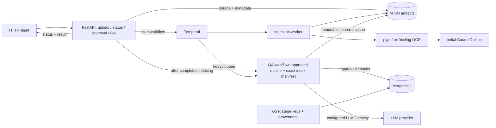
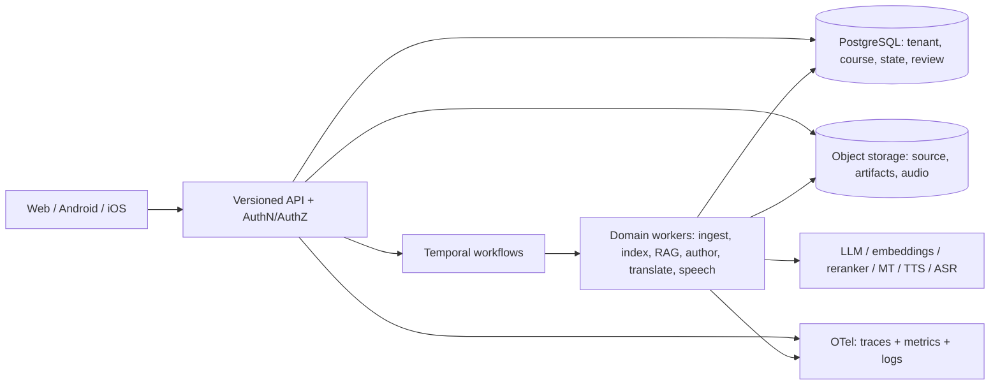

# 01 — معمارية B2C

## الغرض وحدود الوثيقة

تفصل هذه الوثيقة بين ما يعمل حاليًا في المستودع وما هو تصميم مستهدف للتوسع. وجود حزمة أو خدمة أو عقد في مخطط الهدف لا يعني أنها مطبقة. سجل القرارات في `docs/00-DECISIONS.md` وخطة المراحل والبوابات في `docs/05-PHASES.md` هما المرجعان التنفيذيان.

المشروع منصة بحثية لتحويل الكتب إلى كورسات. النموذج المستهدف يستخدم كتابًا أساسيًا لترتيب الدروس، وكتبًا مساندة لإضافة شروح وأمثلة مع توثيق مصدرها. المسار الحالي محدود برفع PDF واستخراجه وبناء outline ومراجعته؛ لا يوجد بعد مسار منتج مكتمل من كتابين إلى RAG ثم ترجمة وصوت وتطبيق هاتف.

## رؤية المنتج وخطة النظام

### الرؤية
تمكين مؤلف الكورس من تحويل فصل من كتاب أساسي إلى مسار تعليمي عربي، مع الاستعانة بكتب مساندة لإضافة تعريف أو برهان أو مثال من دون طمس مصدره. يتلقى المتعلم دروسًا قابلة للقراءة والاستماع، وكل ادعاء أو مثال يمكن رده إلى الكتاب والصفحة. الواجهة النهائية المقصودة ويب وAndroid؛ ملفات MP3 جزء من التسليم الصوتي وليست وسيط التخزين الوحيد للمحتوى.

### تدفق المنتج المستهدف
1. اختيار كتاب أساسي وكتب مساندة وتسجيل الحقوق ونطاق الاستخدام لكل مصدر.
2. رفع PDF وفحصه واستخراج النص والصفحات والجداول والصور، مع OCR عربي/إنجليزي عند الحاجة.
3. مراجعة outline مستند إلى بنية الكتاب، ثم تحديد الدروس المراد إنتاجها.
4. تقسيم المحتوى حسب البنية، وفهرسة dense/sparse/graph خلف واجهة موحدة؛ يبدأ الاسترجاع بالكتاب الأساسي ويضيف شواهد الكتاب المساند مع الإسناد.
5. إنشاء أهداف الدرس والشرح والأسئلة من سياق مسترجع، مع منع النشر إذا غابت الإحالات أو فشل التحقق.
6. ترجمة المحتوى إلى العربية الفصحى مع termbase وقياس جودة ومراجعة بشرية لما لا يجتاز الحدود.
7. تشكيل النص وتوليد الصوت، وفحص النطق والمدة والتوقيت، ثم إنشاء MP3 موصوف ببيانات النموذج والترخيص وبصمة النص والصوت.
8. إصدار نسخة كورس ثابتة قابلة للتشغيل على الويب والهاتف، مع متابعة التقدم ومراجعة المحتوى وتحديثه بإصدارات جديدة.

### نطاق أول إصدار بحثي
النطاق الحالي كما في D-017 فصل من كتاب أساسي وفصل مساند واحد. لا يعني ذلك أن تحميل كتاب واحد أو نجاح outline يمثل MVP. يلزم المسار الكامل مع RAG والإسناد والترجمة والصوت وتجربة تشغيل متعلم؛ وتظل الحقوق والقبول البشري شرطًا قبل مشاركة أي محتوى. تفاصيل الترتيب وبوابات القبول في docs/05-PHASES.md، ونتائج التنفيذ في docs/PROJECT-STATUS.md.

### خصائص النجاح المستهدفة
- تغطية كل درس لمصدره الأساسي مع إظهار مساهمات الكتب المساندة منفصلة.
- عدم إصدار جملة تعليمية أو سؤال بلا citation قابل للتحقق.
- قياس OCR والترجمة والصوت على مجموعات gold معلّمة بشريًا، لا على الانطباع أو حالة اصطناعية واحدة.
- إعادة تشغيل كل مرحلة من artifacts وإعدادات وإصدارات ثابتة، مع عدم تكرار المخرجات أو فقد المصدر.
- تسليم ملف MP3 صالح وتشغيله من التطبيق مع بيانات لغة/درس/صوت/ترميز وتوقيتات المقاطع.
- ألا يوصف النظام بأنه قابل للنشر قبل اجتياز الأمن والعزل والاستعادة والأداء والإتاحة والحقوق.

هذه رؤية وخطة هدف؛ حالة التطبيق الفعلية والفجوات تظهر في القسم 1 وجدول التقدم في PROJECT-STATUS.

## 1. الحالة الحالية

| الجزء | الموجود فعليًا | الفجوات الحالية |
|---|---|---|
| `contracts` | نماذج Pydantic لعناصر الرفع والتحليل وoutline وchunks وKG والدروس والأسئلة والصوت، و`stage_key` | العقود أوسع من التنفيذ. `schema_version` موجود لكن لا توجد سياسة كاملة للتوافق والترحيل بين الإصدارات. |
| `api` | FastAPI لرفع PDF وحالة ingestion واعتماد outline؛ وبعد اكتمال الفهرسة يطلق توليد Q/A ويعرض نتيجته | لا مصادقة أو تفويض أو عزل tenant. `course_id` نطاق تسمية وليس حاجزًا أمنيًا؛ مسار التأليف لم يثبت بتشغيل container أو مزود حي. |
| `orchestration` | Temporal لمسارات ingestion وindexing وتوليد Q/A المصدرية على heavy queue | replay وidempotency واختبارات الخدمة الحية للمراحل اللاحقة ما زالت مطلوبة. |
| `ingest`, `outline` | استخراج PDF عبر pypdf وDocling/OCR، إنتاج `ParsedBook` وoutline أولي | جودة OCR العربي/الإنجليزي على مجموعة ممثلة لم تثبت بعد؛ لا قبول جودة تجاري. |
| `core` | تخزين artifacts متوافق مع S3 في MinIO مع manifests وبصمات؛ إعدادات وlogging وprovenance في PostgreSQL | النسخ الاحتياطي والاستعادة والاحتفاظ والعزل لم تثبت تشغيليًا. |
| `llm_gateway` | عميل متوافق مع OpenAI وcache | لا تفترض اكتمال بوابة موحدة وحوكمة لكل المهام والمزودين قبل تنفيذ واختبار ذلك. |
| `indexing`, `kg`, `synthesis`, `pedagogy`, `translation`, `speech` | indexing يخزن chunks بمصدرها؛ وpedagogy يولد أسئلة لكل درس/وحدة/كورس مع اقتباس مطابق وحكم آلي، عبر مسار API/Temporal | بوابة Phase 3 وG2 مفتوحتان؛ faithfulness المرجعي، linter/solver/FSRS والمراجعة الخبيرة لا تزال مطلوبة. LightRAG وQE وTTS ليست جاهزة لمجرد ورودها في الخطط. |
| Docker Compose | إعدادات B2C لـ PostgreSQL/pgvector وMinIO وTemporal وAPI/worker وخدمات مراقبة؛ overlay اختياري لـ OpenRouter | إعداد Compose لا يثبت اجتياز stack كامل أو جاهزية إنتاجية. البيئة محلية/بحثية. |
| Web / Android / iOS | عميل Android تشغيلي للاختبار والتحكم في مراحل الكتاب عبر API موجود؛ واجهة تعلم نهائية غير موجودة | اختبارات الاستخدام وE2E على Android 7/8، وإتاحة المشغل والتوزيع/تحديث التطبيق ما زالت مطلوبة. |

الحدود المقصودة: `contracts` مستقل؛ `core` يقدم خدمات البنية المشتركة؛ حزم المجال لا تستورد API أو orchestration؛ API يستقبل الطلبات؛ وTemporal ينسق أنشطة المجال دون احتواء منطق المعالجة الثقيل. يجب فرض القواعد آليًا بـ import-linter وCI؛ لا نفترض أن القاعدة مكتملة لمجرد توثيقها.

### مسار البيانات الموجود



يحفظ الرفع المصدر والبيانات كـ artifact ببصمة، ثم يبدأ workflow بمعرف ثابت لتسهيل إعادة الطلب. بعد اعتماد المخطط وفهرسة الكتاب، يمكن للعميل طلب توليد Q/A؛ المسار يتحقق من تطابق بصمة المخطط وقائمة chunks مع نتيجة الفهرسة، ثم يحفظ الأسئلة مع إسناد المصدر والصفحة. هذا ليس بعد إصدار CourseRelease كاملًا ولا تدفقًا من مصدرين إلى كورس مترجم ومنطوق.

### الاختبارات والرصد

توجد اختبارات unit وcontract واختبارات integration محدودة. مجلدا `tests/golden` و`tests/e2e` لا يحتويان corpus ومسارات قبول مكتملة. إعدادات OTel وPrometheus/Grafana وLangfuse موجودة في ملفات النشر؛ وجود الإعدادات لا يثبت تغطية traces/metrics/logs أو تنبيهات تشغيلية. الأدلة الفعلية تسجل في تقارير المراحل.

## 2. مبادئ التصميم المستهدف

1. **عقود ذات إصدارات:** لكل artifact schema وإصدار وقيود تحقق، مع ترحيل أو رفض صريح للنسخ غير المتوافقة. لا منطق تنفيذي داخل `contracts`.
2. **مصدر حقيقة واضح:** الكتب والمخرجات الكبيرة والصوت في object storage؛ الحالة والفهرسة والملكية والمراجعات والبيانات الوصفية في PostgreSQL. لا تخزن ثنائيات الكتب/MP3 في قاعدة البيانات.
3. **مراحل قابلة للإعادة:** مفتاح المرحلة يعتمد على بصمات المدخلات وإعدادات وإصدارات الكود والنموذج والموجه. المخرجات المنشورة immutable؛ التصحيح ينشئ نسخة جديدة مرتبطة بسابقتها.
4. **تنسيق رفيع:** Temporal يدير الترتيب والانتظار والإعادة والإلغاء. منطق المجال يبقى في حزم المجال، وآثار الأنشطة الجانبية تكون معلومة وقابلة للتعافي.
5. **مزودون قابلون للتبديل:** واجهات موحدة لـ LLM وembedding وreranker وMT وTTS وASR، مع إعلان الإصدار والترخيص واللغات ومتطلبات الموارد. لا تربط العقود بموديل بعينه.
6. **إثبات المصدر:** كل مقطع ومعلومة وترجمة وصوت يحتفظ بعلاقات إلى الكتاب والصفحات والكتل والمصادر، وإصدارات النموذج والإعدادات والناتج.
7. **أمن متعدد المستأجرين قبل فتح الخدمة:** المصادقة والتفويض وسياسة tenant تطبق على API وقاعدة البيانات والكائنات والـ workflows. `course_id` أو UUID غير كافٍ للعزل.
8. **تشغيل قابل للرصد:** سجلات منظمة وmetrics وdistributed traces بمعرفات workflow/artifact، دون تسجيل نصوص الكتب أو الأسرار افتراضيًا؛ قياس تأخر الطوابير والفشل والمدة والموارد، مع تنبيهات ونسخ واستعادة مجربة.
9. **API مستقل عن العملاء:** API versioned حد المنتج للويب والهاتف، ومنطق العمل لا يعيش في UI. يحدد دعم التنزيل/offline والمزامنة بعد تحديد الحقوق والتحديث.
10. **الصوت وMP3:** احتفظ بمواد وسيطة مناسبة للتحرير والتجميع ثم أنشئ MP3 للتسليم مع metadata للترميز والمدة ومعدل العينة وloudness وتقسيم المقاطع والتوقيت. لا تحول النسخة المضغوطة مرارًا؛ سجّل بصمات كل rendition. حدد bitrate/codec بالقياس لا بالتخمين.

## 3. المعمارية المستهدفة بعد اكتمال المراحل



ابدأ modular monolith مع عمال منفصلين حسب الحمل، ولا تقسم مبكرًا إلى خدمة وقاعدة بيانات لكل مجال. افصل خدمة مستقلة عندما يبرر ذلك حمل مختلف أو ملكية أو أمان أو نشر مستقل. التقسيم المنطقي: `contracts`، `core`، `api`، حزم المجال (`ingest`, `outline`, `indexing`, `kg`, `synthesis`, `pedagogy`, `translation`, `speech`)، و`orchestration` للـ workflows/activities الرفيعة.

### RAG والكتب المتعددة

يحدد الكتاب الأساسي spine ترتيب الدروس؛ الكتب المساندة توفر تعريفات أو براهين أو أمثلة. كل chunk مفهرس يجب أن يحمل عند دعم تعدد المستأجرين `tenant_id`، و`course_id`, `book_id`, role، مرجع الصفحة/الكتلة، hash وإصدارات parser/model وحقوق الوصول. يطبق الاسترجاع حدود الصلاحية قبل إرجاع السياق، ويربط كل نتيجة بمصدر قابل للتحقق. الكيانات والعلاقات ومقترحات الدمج والمراجعات artifacts بإصدارات. لا يوجد حتى الآن ما يثبت تنفيذ LightRAG/Concept Layer أو اجتياز بوابته.

### الترجمة والصوت

تظل النصوص الأصلية والمترجمة وحدات مستقلة مرتبطة بـ sentence IDs والمصادر وtermbase وإصدارات الترجمة والمراجعة. يسجل تعديل الإنسان منفصلًا عن نص النموذج. في الصوت: تطبيع وتشكيل وتقسيم، ثم مزود TTS وفحوص وضوح وloudness ومدة وتوقيت، ثم تجميع. أنشئ MP3 للتوزيع مع `segments.json` وتوقيتاته وبصمات النص والصوت وmetadata encoder؛ واحتفظ بوسيط lossless إن كان مطلوبًا لإعادة التجميع أو التحرير.

## 4. فجوات التوسع ومعايير القبول المقترحة

| المجال | الفجوة | معيار الإنجاز |
|---|---|---|
| الحدود | حزم متعددة لكن التنفيذ مركز في API وingest وoutline وcore وTemporal | قواعد imports في CI وواجهات واضحة واختبارات لكل package |
| العقود | `schema_version` بلا سياسة ترحيل مكتملة | اختبارات serialization والتوافق، وسياسة كسر/توسيع، ومسار للـ artifacts القديمة |
| idempotency | stage key موجود؛ الكتابة موزعة بين S3 وDB وTemporal | اختبارات الكتابة الجزئية والتزامن والإعادة والتعافي وعدم تكرار الآثار |
| الأمن | لا AuthN/AuthZ أو tenant boundary | نموذج تهديد، صلاحيات، عزل في الاستعلام والتخزين والـ workflows، وإدارة أسرار واحتفاظ/حذف |
| RAG | indexing/KG لم يكتمل وقياسات الاسترجاع غير متاحة | corpus مرخص، recall/precision وgroundedness، منع تسرب مصادر ومراجعة بشرية |
| OCR | جودة الصفحات العربية/الإنجليزية الرديئة غير مثبتة | CER/WER حسب نوع الصفحة، ترتيب القراءة ومراجع المصدر، زمن وذاكرة |
| ترجمة وصوت | pipelines غير مقاسة | تقييم بشري وآلي معاير، وضوح الصوت، تراخيص، MP3 وتوقيت وحجم |
| الاختبارات | unit/contract لا تكفي لقبول تجاري؛ golden/E2E غير مكتملة | traceability، integration/E2E، فشل واستعادة وأمن وأداء وإتاحة |
| التشغيل | Compose محلي وإعدادات الرصد لا تعني جاهزية إنتاجية | backup/restore مجرب، SLO/alerts، migrations/secrets، rollback وتحديث موثق |
| العملاء | لا Web/Mobile | API مستقر وتجربة RTL وإتاحة، ومتطلبات مزامنة وتشغيل قبل APK |

هذه معايير تطوير داخلية وليست ادعاء شهادة أو امتثال لمعيار. تقييم الاختبارات في `docs/COMMERCIAL-QUALITY-PLAN.md`، والأدلة في `eval/reports/`.

## 5. خطوات انتقال صغيرة

1. **إقفال Phase 2:** اختبر OCR العربي والإنجليزي ببيانات مرخصة واختبر upload إلى outline approved على خدمات B2C، واحفظ المقاييس والتقرير.
2. **Phase 3–4:** نفذ indexing بعقود ومصدرية واضحة؛ أضف GraphRetriever/LightRAG خلف واجهة بعد تحديد corpus وقياسات الاسترجاع.
3. **Phase 5–6:** نفذ enrichment/pedagogy والتحقق من citations. اجعل HippoRAG مقارنة اختيارية حتى ينجح benchmark ومراجعة الأمان.
4. **Phase 7–8:** نفذ الترجمة وQE والمراجعة ثم TTS وتجميع الصوت؛ اختر intermediate وMP3 بالقياس.
5. **Phase 9:** ثبت API المنتج ثم ابنِ Web/Mobile كعميلين مستقلين، وأكمل المصادقة وعزل tenant قبل تعدد المستخدمين.
6. **Phase 10:** أكمل hardening والنسخ والاستعادة والرصد والتنبيهات واختبارات الحمل والفشل؛ لا تصف النظام بأنه production-ready قبل اجتياز بوابات القبول وتوثيق الحدود.

## 6. تنظيم المستودع

```text
book2course/
├── docs/                 # قرارات، عقود، مراحل، جودة وتشغيل
├── docker/               # Compose وخدمات B2C
├── packages/
│   ├── contracts/        # schemas فقط
│   ├── core/             # artifacts, settings, provenance, logging
│   ├── api/              # HTTP boundary
│   ├── orchestration/    # Temporal workflows/activities رفيعة
│   └── <domain packages>/# منطق المجال وواجهات المزودين
├── eval/                 # golden corpora, suites, benchmarks, reports
└── tests/                # unit, contract, integration, golden, e2e
```

وسع التنظيم عند وجود كود حقيقي؛ لا تنشئ تطبيقات/خدمات فارغة لمطابقة الرسم. مجلدات الاختبارات الفارغة تظل فجوات حتى تحتوي حالات قابلة للتشغيل وبيانات مرخصة.
