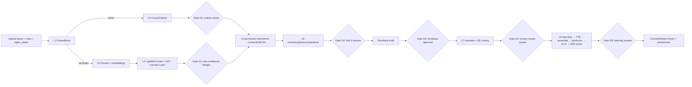
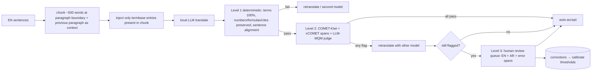
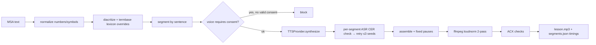

# 01 — المعمارية (Architecture)

## 1. المبدأ
المشروع pipeline من طبقات مستقلة (layered, composable). كل طبقة:
- بتاخد artifacts لها **عقد (contract)** معرّف في `b2c_contracts`.
- بتطلع artifacts لها عقد معرّف.
- **idempotent**: نفس المدخلات + نفس الإعدادات = نفس الـ key، فالطبقة مابتعيدش الحساب.
- **قابلة للاختبار لوحدها**: ليها golden fixtures واختبارات خاصة بيها.

ترتيب الطبقات مايعرفهوش غير `orchestration`، والطبقات نفسها ماتعرفش بعض.

## 2. الطبقات

| # | الطبقة | Package | Input | Output | الأداة |
|---|---|---|---|---|---|
| L1 | Ingestion | `ingest` | `BookUpload` | `ParsedBook` | Docling (+OCR لكل صفحة حسب الحاجة) |
| L2 | Outline | `outline` | `ParsedBook` (spine) | `CourseOutline` | bookmarks ← headings ← LLM |
| L3 | Chunking & Index | `indexing` | `ParsedBook` | `StructuredChunk[]` + embeddings | bge-m3 |
| L4 | Knowledge Graph | `kg` | `StructuredChunk[]` | LightRAG graph + `ConceptEdge[]` | LightRAG + Concept Layer |
| L5 | Enrichment | `synthesis` | `Lesson` + KG | `LessonDraft` (EN) | LightRAG mix + rerank + LLM |
| L6 | Pedagogy | `pedagogy` | `LessonDraft` | summary, glossary, `Question[]`, cards | LLM + linters + py-fsrs |
| L7 | Translation | `translation` | EN artifacts + `TermbaseEntry[]` | `TranslationUnit[]` (AR) | LLM + QE + review queue |
| L8a | Diacritization | `speech.diacritize` | AR text | AR text مشكّل | CATT / Sadeed (بالقياس) |
| L8b | TTS | `speech.tts` | segments | wav segments | `TTSProvider` |
| L8c | Audio QA | `speech.audio` | segments | `AudioAsset` | ffmpeg loudnorm + ACX + ASR |
| L9 | Orchestration | `orchestration` | — | workflows | Temporal |
| L10 | Serving | `api` + `web` | releases | REST + UI | FastAPI + SPA |
| — | Cross-cutting | `core`, `llm_gateway`, `contracts` | — | — | — |

## 3. مخطط النظام

```mermaid
flowchart TB
  subgraph WSL2["Ubuntu (WSL2) — compose project b2c — budget 60GiB / 40 CPU"]
    UI[web: Reader + Audio + Quiz + SRS] --> API[api: FastAPI /v1]
    API --> PG[(PostgreSQL + pgvector)]
    API --> S3[(Object store)]
    API -->|start/ signal| TW[Temporal server]
    TW --> WK[Workers: queues light / heavy(concurrency=1) / io]
    WK --> LR[LightRAG server — internal network + API key]
    LR --> PG
    WK --> GW[llm_gateway: cache + structured output + tracing]
    LR --> GW
    GW --> LLM[llama-server: local GGUF only]
    WK --> EMB[embed-rerank: bge-m3 / bge-reranker-v2-m3]
    LR --> EMB
    WK --> TTS[tts providers]
    WK --> ASR[asr]
    WK --> PG & S3
    GW & WK & LR --> OT[OTel collector] --> LF[Langfuse v4] & PR[Prometheus → Grafana]
  end
  OTHER[مشاريع تانية على نفس الجهاز — ممنوع اللمس] -.-x WSL2
```

## 4. تدفق البيانات



## 5. طبقة الـ Knowledge Graph

```mermaid
flowchart TB
  CH[StructuredChunks of book X] --> INS[LightRAG insert: file_path = book_id#pages]
  INS --> KG[(entities / relations / vectors in PG)]
  KG --> ER[Entity resolution: bge-m3 cosine candidates → LLM judge]
  ER -->|high confidence| MERGE[merge via LightRAG KG management API ❓VERIFY]
  ER -->|low confidence| G1[review queue]
  KG --> CL[Concept Layer: classify relation → typed ConceptEdge]
  CL --> CE[(concept_edges table)]
  Q[lesson concepts] --> RET[LightRAG mode=mix + reranker, only_need_context]
  RET --> FIL[filter: supplementary book OR other chapter; not already covered]
  CE --> FIL
  FIL --> SC[SupplementCandidate list]
```



**قواعد الطبقة دي:**
- أنواع الكيانات بتتعرف مركزيًا: `concept, definition, theorem_or_law, formula, method_or_algorithm, example, person, tool_or_technology, misconception`. VERIFY طريقة تمريرها لـ LightRAG في الإصدار المثبت.
- كل كتاب ليه `doc_id` في LightRAG. الحذف بيتعمل بالـ API، وLightRAG بيعيد بناء الأجزاء المتأثرة.
- مفيش أي علاقة في الـ Concept Layer من غير `evidence_chunk_ids`.

## 6. طبقة الإثراء (Enrichment) لكل درس

```mermaid
sequenceDiagram
  participant O as Orchestrator
  participant S as synthesis
  participant K as kg (LightRAG)
  participant G as llm_gateway
  O->>S: Lesson (spine span)
  S->>G: extract lesson concepts (JSON schema)
  S->>K: query(mix, rerank, only_need_context) per concept
  K-->>S: contexts + source chunk ids
  S->>S: filter + novelty(cosine) + NLI/LLM classify: new_info|elaboration|example|redundant|contradiction
  S->>G: generate LessonDraft with [[cite:chunk_id]] per sentence (JSON schema)
  S->>S: validator: every sentence ≥1 citation; citations exist; faithfulness check
  S-->>O: LessonDraft or failure → review
```

## 7. طبقة الترجمة ومراجعتها (D-016)



## 8. طبقة الصوت



## 9. المراجعة البشرية (Gates)
| Gate | بعد | المحتوى | إجباري؟ |
|---|---|---|---|
| G0 | L2 | الـ outline | إجباري لو `toc_source=llm_inferred` |
| G1 | L4 | دمج الكيانات منخفض الثقة + التناقضات | لو وُجد |
| G2 | L6 | أول 3 دروس | إجباري |
| G3 | قبل L7 | الـ termbase كامل | إجباري |
| G4 | L7 | طابور الجمل المشكوك فيها | إجباري لو الطابور مش فاضي |
| G5 | L8 | عينة استماع | إجباري |

كل gate بيتنفذ كـ Temporal signal. الـ workflow بيستنى القرار، والانتظار ده بيصمد مع إعادة التشغيل.

## 10. هيكل المستودع

```
book2course/
├── CLAUDE.md
├── Makefile
├── docs/                      # الوثائق دي
├── docker/
│   ├── compose.yml            # b2c services (limits إلزامية)
│   ├── compose.observability.yml
│   └── llm/                   # models path + server args
├── packages/
│   ├── contracts/             # Pydantic فقط — لا منطق — لا imports من باقي الحزم
│   ├── core/                  # stage_key, artifact store, PROV, config, logging
│   ├── llm_gateway/           # OpenAI-compatible client, cache, JSON-schema output, OTel
│   ├── ingest/  outline/  indexing/
│   ├── kg/                    # LightRAG client, entity resolution, concept layer
│   ├── synthesis/             # enrichment, novelty/redundancy, citation validator
│   ├── pedagogy/              # questions, Haladyna linter, bloom, fsrs wrapper
│   ├── translation/           # termbase, injection, deterministic checks, QE, review queue
│   ├── speech/ (diacritize/, tts/providers/, audio/)
│   ├── orchestration/         # Temporal workflows + activities (رقيقة)
│   └── api/
├── web/
├── eval/
│   ├── golden/                # fixtures + expected outputs (OpenStax)
│   ├── suites/                # eval scripts لكل phase
│   ├── bench/                 # Phase 1 benchmark protocol
│   └── reports/               # phase-N.md
└── tests/ (unit/ contract/ golden/ integration/ e2e/)
```

**قواعد الحدود (بتتفرض بـ import-linter في CI):**
- `contracts` ماتستوردش أي حزمة تانية.
- حزم الطبقات (ingest…speech) مسموحلها تستورد `contracts` و`core` و`llm_gateway` بس.
- `orchestration` بتستورد الطبقات، والطبقات ماتستوردهاش.
