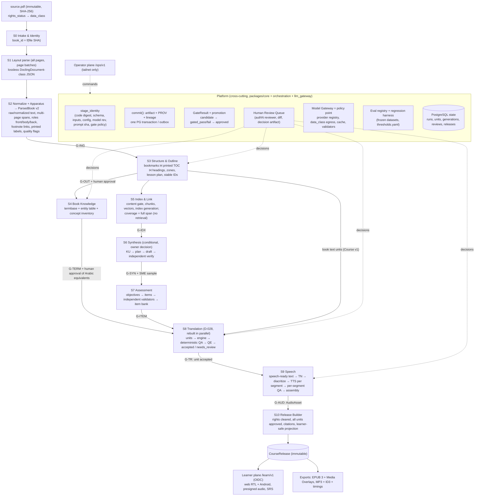

# 00: خطة إعادة الهيكلة الشاملة لـ Book2Course

- **التاريخ:** 2026-10-24
- **الكاتب:** المعماري الرئيسي (مراجعة لتقارير التدقيق 01–09 ولكتالوج أخطاء الترجمة)
- **الحالة:** مقترح. لا يصبح ملزمًا إلا بعد قرارات المالك في القسم 7 وتسجيلها في `docs/00-DECISIONS.md`.
- **المدخلات:** `01-ingest.md` … `09-delivery-api-app.md`، و`outputs/translation-review-2026-10-24/TRANSLATION-ERROR-CATALOGUE.md`، و`docs/proposals/2026-10-24-translation-rebuild.md` (D-028، Accepted).
- **المنهج:** قراءة كاملة للتقارير العشرة، ثم تحقق شخصي بالقراءة فقط من 11 ادعاءً في الكود والبيانات (القسم 1.5). لم يُعدَّل أي كود أو بيانات، ولم يُنفَّذ أي أمر داخل الحاويات.
- **نطاق الترجمة:** الترجمة يُعاد بناؤها بالتوازي وفق D-028. هذه الخطة لا تعيد تخطيطها. تعاملها كمرحلة واحدة (S8)، وتحدد فقط عقود دخولها وخروجها ونقاط تكاملها مع المراحل الأخرى.

---

## 0. الخلاصة التنفيذية

1. **النمط واحد في كل المراحل التسع:** البوابات تفحص الشكل لا الصحة. لذلك تعني «COMPLETED» و«approved» و«PASS» أن العملية لم تنهَر، لا أن الناتج صحيح. ظهر هذا النمط في كل مرحلة بالأرقام. أمثلة: الترجمة فيها 57.4% قبول خاطئ، والمخطط المعتمد لكتاب Chalcraft فيه 0 من 8 فصول، والصوت يفشل في T-AUD-01 بنسبة 15/15، وتغطية الدروس تُحذف بصمت بنسبة 15%.
2. **ثلاث مراحل غير موجودة فعليًا في مسار المنتج:** التأليف (0 `LessonDraft`)، والـ Knowledge Graph (0 صفوف و0 artifacts)، وتسليم المتعلم (0 `course-release`). «الكورس» اليوم هو نص الكتاب مترجمًا ومنطوقًا، ومعه أسئلة إنجليزية لم يُترجم منها إلا جزء.
3. **الجذر المعماري:** المنصة صُممت كمنفّذ متين مع cache، لا كـ pipeline بوابات وترقية. لا يوجد مفهوم `GateResult` ولا `promotion` ولا هوية لكل وحدة. والحالة الحقيقية مخزنة في JSON قابل للكتابة فوقه تحت `_system/`، وهي 96.7% من كائنات الـ bucket. الكود العامل لا يطابق git.
4. **أهم مشكلة عابرة للمراحل:** حبيبية الاستخراج تحدد مصير كل ما بعدها. تحققتُ بنفسي من أن وحدات الترجمة تطابق blocks الاستخراج واحدًا لواحد (776 و2620). وسيط طول المصدر في كتاب SAT هو 850 حرفًا، و651 من 776 وحدة فيها فواصل أسطر صلبة. والقبول الخاطئ يرتفع مع الطول **حتى في المقاطع ذات المصدر السليم**، من 25.8% إلى 94.0%. إذن إصلاح الاستخراج **شرط لازم** لجودة الترجمة والصوت والأسئلة، لكنه **غير كافٍ**: كتاب Gramsci وسيط طول وحداته 117 حرفًا، ومع ذلك قبوله الخاطئ 54.9%.
5. **التوصية:** أولًا مرحلة احتواء قصيرة. ثم بناء أساس منصة واحد يجعل البوابات والـ provenance والمراجعة البشرية إلزامية بالبناء. ثم إعادة بناء المراحل بالترتيب: استخراج، ثم مخطط، ثم معرفة الكتاب (termbase)، ثم فهرسة، ثم ترجمة (D-028)، ثم صوت، ثم إصدار. التأليف والتقويم مسار مشروط بقرار المالك عن شكل المنتج.

---

## 1. المراجعة النقدية للتقارير

### 1.1 تناقضات بين التقارير

| # | التناقض | التقارير | الحكم بعد الفحص |
|---|---|---|---|
| T1 | 07 يقول إن المسارات الصوتية الـ 15 كلها من book1 (SAT)، ويبني على ذلك أن خطأ الترجمة 65.5% «يمر إلى الصوت» (C3). أما 09 فوجد أن المسار `1b9186f6` يحمل معرّف درس SAT لكن نصه من ترجمة كتاب Gramsci، وأن نص المسارات السبعة من نوع `source-text` يطابق ترجمات **DeepSeek**، ولا يطابق ترجمات Hy-MT2 التي راجعها الكتالوج. | 07، 09 | 09 أدق لأنه طابق النص فعلًا. **جودة ترجمة النص المنطوق غير مقيسة**، ولا يجوز إسقاط 57.4% أو 65.5% عليها. يبقى صحيحًا أن الصوت لا يفحص حالة جودة المقطع. |
| T2 | هوية الكتاب: 01 يثبت أن الملف نفسه (SHA `70c88ae9…`) عولج تحت `book-main` وتحت `book-70c88ae9…`، و03 يعتبر ذلك UNVERIFIED. و`book-main` هو أيضًا معرّف كتاب SAT في 02 و03 والكتالوج. و09 يذكر معرّفًا ثالثًا هو `book-aaea5c4b…`. | 01، 02، 03، 09 | كل تقرير رأى جزءًا من الصورة. مجموعها يقول إن **معرّفًا واحدًا (`book-main`) حمل كتابين مختلفين**، وإن الكتاب الواحد حمل حتى ثلاثة معرّفات. صنّفه 09 متوسطًا (M5)، وأرفعه إلى **حرج عابر للمراحل** لأنه سبّب نطق كتاب آخر تحت عنوان درس. |
| T3 | أرقام مخطط SAT: §3.1 من 02 يقول إن إعادة تشغيل الكود الحالي تنتج 18 module و78 درسًا، و§3.3 يحلل اعتمادًا فيه 20 module و81 درسًا. | 02 | التقرير لا يفسر الفرق. التفسير الأرجح انحراف الكود بين الصورة المنشورة وHEAD (01 §2.3، و08 C3). وهذا يؤكد أن الـ artifacts الحالية لا يمكن إعادة إنتاجها. |
| T4 | HEAD مختلف في كل تقرير: `5870d57` في 01، و`ee8ea5b` في 08، و`db60cf7` في 09. وعند كتابة هذه الخطة HEAD هو `df10c29` (عمل D-028 جارٍ). | 01، 08، 09 | **أرقام الأسطر في التقارير تنجرف.** مثال: إعداد الترميز الذي يذكره 07 عند `audio_renderer.py:314` موجود الآن عند `:207`. الأرقام المقيسة صالحة، أما مراجع الأسطر فتُقرأ كمؤشرات. |
| T5 | ترقيم المراحل غير موحد: 06 يسمي المخطط «المرحلة 03» والترجمة «07» والصوت «08»، و08 يسمي الترجمة «07»، بينما ملفات التدقيق تجعل 07 للصوت. | 06، 08 | الترقيم مختلط بين ترقيم ملفات التدقيق وترقيم `05-PHASES`. هذه الخطة تستخدم معرّفات مراحل جديدة (S0…S10) في القسم 2. |
| T6 | 01 ينسب الـ 32.1% من المقاطع ذات المصدر المعيب كلها إلى الاستخراج، ويوحي بأن إصلاحه يحل جزءًا كبيرًا من فشل الترجمة. أما الكتالوج (§1.5 بند 4) فيقول إن مشكلات المصدر «ليست السبب الرئيسي»: 62.6% مقابل 55.1%. | 01، الكتالوج | كلاهما صحيح جزئيًا، والقياس الذي أجريته يوفق بينهما: **الطول** هو العامل الأقوى، والطول نفسه ناتج عن حبيبية الاستخراج في book1. أما في book2 فالسبب الرئيسي هو النموذج والـ prompt. |
| T7 | 04 يقول إن غياب الـ KG «سبب جذري مباشر» لـ 716 خطأ مصطلحي. والكتالوج وD-028 يعالجان ذلك بـ termbase لكل كتاب داخل الترجمة (`termbase.py`). | 04، الكتالوج، D-028 | ادعاء 04 مبالغ فيه: الـ termbase لا يحتاج graph. والصحيح أن هناك **مالكَين محتملين لنفس الـ artifact**، ويجب حسم المالك (القسم 2.2، المرحلة S4). |
| T8 | إصدار العقد: 02 يقترح «schema 1.2.0» للمخطط، لكن `SCHEMA_VERSION` في الكود هو 1.2.0 أصلًا (D-028). و04 يقترح الرفع «من 1.2.0». | 02، 04، الكود | تصادم إصدارات. كل تغيير عقد قادم يأخذ رقمًا جديدًا عبر سجل إصدارات واحد (المبدأ P1). |
| T9 | 05 يقول إن 19 من 21 artifact تفشل قاعدة Bloom، و06 يقول إن كل MCQ ولّده LLM فشل بوابة الـ blind solver. | 05، 06 | لا تناقض في الجوهر، لكنه تكرار: كلاهما يصف مسار `lesson_enrichment` نفسه. يُدمجان في المرحلة S6/S7. |

### 1.2 ادعاءات بلا دليل كافٍ أو بدليل ضعيف

| الادعاء | التقرير | لماذا هو ضعيف | المعاملة في الخطة |
|---|---|---|---|
| ترتيب LightRAG `mix` يساوي ترتيب dense | 04 §3.4 | استنتاج من تطابق المتوسطات، والـ rankings لكل سؤال غير محفوظة (التقرير نفسه يقول UNVERIFIED) | لا يُبنى عليه قرار. قرار حذف مسار الرسم يستند إلى أدلة أقوى: 0 استخدام، ومخالفة القاعدتين 5 و6. |
| CER الصوت 7.4–22.9% | 07 §3.5 | مقيس بـ Whisper-tiny، وهو غير صالح للعربية كبوابة (التقرير نفسه يقر بذلك) | يُعامل كمؤشر فقط. الـ baseline الحقيقي يُقاس في المرحلة R2 بـ ASR قوي وتسجيل بشري. |
| صلة الربط المساند 0 من 10 | 03 §3.5 | حكم مدقق واحد على 10 دروس، بلا qrels | يكفي لإيقاف `conflict_candidates`، ولا يكفي لاختيار نموذج. |
| أحكام جودة المسودات والأسئلة (14% معيب، 44% ملخص غير مستلزم) | 05 §3.4، 06 §3.2 | مراجع واحد، وعينة 50 و38 جملة، بلا κ | تكفي لإعلان أن Phase 5 غير مغلقة، ولا تكفي كأرقام baseline. تُعاد على gold بمراجعَين. |
| مدة صوتية «حتى 90 دقيقة» للدرس | 02 P8 | تقدير بـ 140 كلمة في الدقيقة | غير مستخدم في الخطة. |
| أرقام أدوات خارجية (MinerU وMarker وCATT DER) | 01 §5.3، 07 H1 | مصادر ثانوية وUNVERIFIED | لا تُعتمد. كل اختيار أداة يُحسم بـ bake-off على بيانات المشروع (المبدأ P3). |
| إرسال نص كتب حقيقية إلى OpenRouter | 04 L3، 08 §3.7، 09 C3 | كل تقرير وسمه UNVERIFIED منفردًا | **مجموع الأدلة يجعله مرجحًا جدًا:** 4,941 استجابة deepseek في `llm_cache` على `b2c-demo` (08)، والنص العربي المنطوق في 7 مسارات يطابق ترجمات DeepSeek لكتاب SAT الحقيقي (09). هذا سؤال مفتوح للمالك (Q4) لأنه يمس القاعدة 6 وD-022. |
| حجم العتبات المقترحة | كل التقارير | التقارير التسعة تقترح أكثر من 100 عتبة جديدة، وأغلبها بلا baseline (بعضها موسوم ❓) | لا تُجمَّد عتبة قبل قياس baseline. المالك يجمّد مجموعة صغيرة كبوابات (Q11)، والباقي مقاييس متابعة. |
| سكربتات القياس نفسها | كل التقارير | الأدلة مولدة بسكربتات في scratchpad جلسة مؤقتة (`/tmp/claude-0/…/scratchpad/`)، لا في المستودع | الأرقام صالحة اليوم، لكنها غير قابلة لإعادة الإنتاج. المرحلة R2 تحوّل هذه السكربتات إلى أدوات قياس في `eval/` قبل أن تُفقد. |

### 1.3 مشكلات عابرة للمراحل (السلاسل السببية)

| # | السلسلة | الدليل | المرحلة المالكة للإصلاح |
|---|---|---|---|
| X1 | **حبيبية الاستخراج ← طول وحدة الترجمة ← القبول الخاطئ.** مسار pypdf ينتج block بحجم الصفحة، ووحدة الترجمة = block، والقبول الخاطئ يبلغ 93% فوق 1000 حرف. | 01 C2، الكتالوج §1.5، وقياسي في 1.5 | S2 (ParsedBook v2)، ثم S8 تقطع جُمليًا |
| X2 | **تباعد حروف OCR ← عناوين مشوهة ← (أ) المخطط ← (ب) BM25 يحذف chunks ← (ج) معرّفات الدروس ← (د) أسماء المسارات الصوتية ← (هـ) ترجمة حرفًا حرفًا.** | 01 H1، 02 P5، 03 C1، 06 §3.4، الكتالوج §2.11 | S2 (تطبيع حتمي)، ثم S3 (عنوان من bookmark) |
| X3 | **غياب تصنيف front/body/back ← فهارس وحواشٍ ومراجع تصبح دروسًا (17.3% من كلمات Chalcraft) ← أسئلة عن ISBN والفهرس ← ترجمة الفهرس ← نطق «[ثلاثة]».** D-027 مقبول لكنه غير فعّال. | 01 C4، 02 P2، 03 C2، 06 M1، 07 §3.4، الكتالوج §3 | S2 (أدوار الكتل)، ثم S3 (`excluded_ranges`) |
| X4 | **الحواشي تفقد أرقامها وروابطها في الاستخراج ← `footnote_marker` في الترجمة (66) ← «جماعي.واحد» في الصوت.** | 01 C4، الكتالوج §2.9، 07 §3.4 | S2 يربط الحاشية بموضعها، وS8 يعيدها بالكود (D-028)، وS9 يحذفها من النص المنطوق |
| X5 | **هوية الكتاب غير مستقرة ← نص كتاب آخر تحت درس SAT ← صوت خاطئ معروض للمستخدم.** | T2، 09 §3.3 | S0 (هوية = SHA المحتوى)، والمنصة P6 |
| X6 | **لا termbase ولا جدول كيانات ← 716 خطأ مصطلحي و215 خطأ أعلام في الترجمة ← نطق غير متسق للأعلام والاختصارات (32 اختصارًا) ← أسماء مفاهيم مختلفة بين الدرس والأسئلة.** | الكتالوج §2.6–2.7، 04 C1، 07 C2 | S4 ينتج الـ termbase مرة واحدة، وتستهلكه S8 وS9 وS6/S7 |
| X7 | **حكم النموذج على نفسه** في الترجمة، والـ QA، والإثراء، وحل الأسئلة. | الكتالوج، 05 C2، 06 C1 | المنصة P2 (محقق مستقل إلزامي) |
| X8 | **غسيل الـ provenance:** checkpoints الترجمة تُختم بهوية التشغيل الجديد (تحققتُ من `translation.py:471-473`)، ومثله في QA (`allow_checkpoint_model_switch`). | 08 C2، 06 H7 | المنصة P5، وS8 |
| X9 | **«completed/partial» يُستهلك كقبول:** الصوت يقرأ ترجمة `partial`، والترجمة تقرأ QA حالتها `failed`. | 06 §3.1، 08 C1، 09 C2 | المنصة P2 (الترقية) |
| X10 | **انحراف الكود المنشور عن git** في worker (01 H4، 08 C3) وapi (09 H1)، ومعه مفتاح Gemini في URL في الصورة المنشورة. | 01 §2.3، 08 §3.5، 09 §3.2 | المنصة، المرحلة R1 |
| X11 | **الاسترجاع يُستخدم للتغطية:** مولد الأسئلة يفقد 15% من chunks الدرس، والعناوين المشوهة تزيد ذلك. | 03 C1 | S5 وS7 (التغطية = كل الـ span) |

### 1.4 توصيات مكررة بين التقارير (تُدمج في بند واحد)

| البند الموحد في هذه الخطة | التقارير التي اقترحته |
|---|---|
| طابور مراجعة بشرية واحد (خدمة منصة) | 01 §5.5، 02 §5.4، 03 §5.6، 04 §5.5، 05 §5.5، 06 §5.4، 07 §5.4، 08 §5.5، 09 §5.6، D-028 |
| سجل موحد لمجموعات التقييم وharness واحد للانحدار | 01 §5.7، 02 §5.6، 03 §5.5، 04 §5.5، 05 §5.7، 06 §5.6، 07 §5.6، 09 §5.8، D-028 §6 |
| محقق مستقل من عائلة نموذج مختلفة، ومعاير على gold | 03، 04، 05، 06، 08، الكتالوج |
| الحالة في PostgreSQL مع Alembic | 08 H1، 09 M1 |
| Build → Release → Run وصورة من commit | 01 H4، 08 C3، 09 H1 |
| تصنيف front/body/back | 01، 02، 03، 06 |
| حذف مسار LightRAG/HippoRAG | 03 §6.3، 04 §6.3 |
| إخفاء الإجابات عن المتعلم | 06 C4، 09 C4 |
| `prior_lessons` الخطية | 02 P12، 04 §1.3 |
| termbase وجدول كيانات ولexicon نطق | 04، 07، الكتالوج، D-028 |
| egress بعيد مرتبط بالحقوق | 04 H3، 08 H4، 09 C3 |
| قرار صيغة الصوت (ACX أو ‎-16 LUFS) | 07، 09 |
| حجب المسارين الصوتيين الخاطئين | 07، 09 |

### 1.5 تحقق شخصي من الادعاءات الأهم (قراءة فقط)

| # | الادعاء | المصدر | ما فعلته | النتيجة |
|---|---|---|---|---|
| V1 | فحص «العنوان موجود في المصدر» معطوب بسبب `r"\\s+"` | 02 P9 | قرأت `packages/outline/src/b2c_outline/review.py:133-134` | **مؤكد** |
| V2 | `citation_support_rate: 1.0` ثابت في الكود | 05 C2 | `grep` في `lesson_enrichment.py` | **مؤكد** (`:975`) |
| V3 | الإثراء معطل افتراضيًا | 05 C1، 06 C2 | `qa.py:104` و`api/schemas.py:48` | **مؤكد** (`False` في الموضعين) |
| V4 | الـ seeding يتجاهل `model_id` و`prompt_version` و`translation_engine` و`provider_id` | 08 C2 | قرأت `orchestration/translation.py:460-480` | **مؤكد**، والتعليق في الكود يبرره بتوفير الكلفة |
| V5 | أرقام الكتالوج الرئيسية | الكتالوج §1 | أعدت حسابها من `translation-errors-full.jsonl` و`review-book{1,2}.jsonl` | **مطابقة تمامًا:** 1904/3319 = 57.4%، وbook1 65.5%، وbook2 54.9%، وشرائح الطول 29.8/46.3/79.0/93.2%، و62.6% مقابل 55.1% |
| V6 | (اكتشاف جديد) أثر الطول مستقل عن عيب المصدر | — | قصرت الحساب على المقاطع ذات المصدر السليم | القبول الخاطئ 25.8% تحت 60 حرفًا، و48.1% بين 60 و299، و79.3% بين 300 و999، و94.0% فوق 1000. وسيط طول book1 = 850.5 حرفًا (و651/776 فيها `\n`)، ووسيط book2 = 117.5. وحدات الترجمة = blocks الاستخراج 1:1 (776/2620) |
| V7 | `embedding_model="unassigned"`، والبحث اللفظي يعيد score>0 فقط | 03 §2 | `grep` في `chunking.py` و`orchestration/indexing.py` و`retrieval.py` | **مؤكد** |
| V8 | `toc_source="headings" if headings else "pdf_outline"`، و`_HEADING` القديم في Surya وOpenRouter، ولا استخدام لـ `HeadingHierarchy` | 01، 02 P1/P4 | `grep` | **مؤكد** (`docling_pdf.py:334`، `surya_ocr.py:242`، `openrouter_ocr.py:122`، و0 نتائج لـ HeadingHierarchy) |
| V9 | الترميز 24kHz و96k | 07، 09 | `grep` في `docker/supertonic/audio_renderer.py` | **مؤكد**، لكن عند `:207` لا `:314` (انجراف الأسطر، T4) |
| V10 | overlay الرسم افتراضيه OpenRouter وdeepseek ومهلة 900s | 04 H3 | قرأت `docker/compose.graph-services.yml:1-12` | **مؤكد** |
| V11 | استجابات المتعلم تعيد `course_qa` و`lesson_assets` كاملة | 06 C4، 09 C4 | قرأت `api/routers/serving.py:105-127` | **مؤكد** (`model_dump` كامل) |
| V12 | `tests/golden` و`tests/e2e` و`web/` فارغة | 01، 02، 09 | `ls` | **مؤكد** |

لم أتحقق من الادعاءات التي تتطلب `docker exec` أو قراءة MinIO وPostgres، لأنها خارج حدود هذه المراجعة. من أمثلتها: عدد الصفوف، وحالة الحاويات، وتطابق نص `1b9186f6` مع Gramsci. أعتمدها كما وردت، مع وسم UNVERIFIED حيث وسمها أصحابها.

---

## 2. المعمارية المستهدفة من البداية إلى النهاية

### 2.1 المخطط



**قراءة المخطط:**
- **كل سهم بين مرحلتين يمر ببوابة (`G-*`).** المستهلك لا يرى إلا artifacts مرقّاة (`approved`) عبر جدول `promotions`، لا مجرد artifacts موجودة.
- **للترجمة مصدران:** نص الكتاب (Course v1، وهو الشكل الحالي للمنتج)، ومسودات الدروس المعتمدة (Course v2، إن قرر المالك). عقد `TranslationUnit` واحد للمصدرين.
- **S4 مرحلة مستقلة.** تنتج الـ termbase مرة واحدة لكل كتاب، وتستهلكه المراحل S6 وS7 وS8 وS9. هذا يحسم التناقض T7.
- **S5 لا يقع على المسار الحرج للترجمة والصوت.** يخدم الربط بالكتب المساندة، وسؤال المتعلم، وتغذية الـ KG.

### 2.2 مسؤولية كل مرحلة وعقدها

| المرحلة | المدخل (عقد) | المخرج (عقد) | البوابة الحتمية الأساسية | البوابة الدلالية/البشرية | مصدر التفاصيل |
|---|---|---|---|---|---|
| S0 Intake | ملف + `rights_status` | `BookUpload` بـ `book_id` = دالة في SHA، و`data_class` | تفرد الهوية: SHA واحد ↔ `book_id` واحد | — | 09، 01 M3 |
| S1 Parse | `BookUpload` | `layout-document.json` بلا فقد (كل الطبقات، prov وbbox لكل جزء) | تغطية الصفحات 100% | — | 01 §5.2 |
| S2 Normalize | S1 | `ParsedBook v2` (عقد جديد، مع adapter توافق v1 مؤقت) | البوابات التسع في 01 §5.4 | page triage للصفحات المعلَّمة | 01 |
| S3 Outline | `ParsedBook v2` | `CourseOutline v2` (`excluded_ranges`، `zone`، `display_title`، معرّفات مستقرة) | تغطية = مدرج + مستبعد صراحة = 100%، و0 عناوين مشوهة، ومقارنة بالمرجع (title/boundary/level F1) | **اعتماد بشري إلزامي** (لا `approve-system` للإنتاج) | 02 |
| S4 Knowledge | `ParsedBook v2` + outline | `book-termbase` + `entity-table` + `concept-inventory` | offsets صالحة، وقائمة رفض الضوضاء، وDAG للمتطلبات (إن وُجدت) | اعتماد المقابل العربي لكل مصطلح وكيان | 04، الكتالوج §2.6–2.7، D-028 `termbase.py` |
| S5 Index | outline + ParsedBook v2 | `StructuredChunk v2` + vectors + `index_generation` | 0 non-body، و0 truncation، وparity = 0 يتيم | عينة 20 chunk لكل كتاب | 03 |
| S6 Synthesis | span + chunks + termbase | `LessonDraft v2` (evidence spans، verdict لكل جملة) | quote exact-match، و0 ترويسات أو إشارات معلقة أو كود خام | محقق مستقل، وعينة SME | 05 |
| S7 Assessment | مسودة أو span + أهداف | `Item` بمعرّف مبني على المحتوى + item bank | قواعد Haladyna، ومفتاح فريد، و0 حقول كاشفة | ensemble solvers، وIWF judge مستقل، وعينة بشرية | 06 |
| S8 Translation | `TranslationUnit` + termbase | `UnitTranslation` (`decision`، و`engine`، و`issues`، و`qe`) | فحوص D-028 الحتمية (التسرب، الأرقام، الخطوط، المصطلحات) | QE دلالي، و`needs_review` | D-028 |
| S9 Speech | وحدات `accepted` فقط + termbase/lexicon | `speech-text.json` + WAV لكل مقطع + `AudioAsset` + `segments.json` | 0 رقم خام أو `[n]` أو لاتيني خارج الـ lexicon، وloudness/TP، ونسبة المدة إلى الحروف | ASR قوي + LID + عينة استماع | 07 |
| S10 Release | كل ما سبق `approved` | `CourseRelease` + manifest لكل وحدة | البوابات الست في 09 §5.6 | عينة طبقية قبل الإصدار | 09 |

---

## 3. المبادئ العابرة (ملزمة لكل مرحلة)

### P1. العقود قانون، ولها سجل إصدارات واحد
- كل حد بين مرحلتين عقد Pydantic في `b2c_contracts`. أي تغيير يرفع `SCHEMA_VERSION` ويحدّث `docs/02-CONTRACTS.md` في الـ commit نفسه (القاعدة 3).
- **سجل واحد للإصدارات** يمنع التصادم (T8). كل عقد جديد يُضاف مع adapter قراءة للإصدار السابق، ولا يُكسر قارئ قديم بصمت.
- **consumer-driven contract tests:** كل مستهلك يملك اختبارًا يقرأ fixture من المنتِج.
- **الـ API:** OpenAPI snapshot في المستودع، وCI يفشل عند كسر غير معلن (oasdiff).

### P2. بوابة عند كل حد، وترقية صريحة
- **نتيجة كل مرحلة `candidate`.** لا تصبح مدخلًا لما بعدها إلا بسجل `promotion` يشير إلى `GateResult` مسجل، فيه: السياسة وإصدارها، والفحوص، والنتائج، والـ negative controls المجتازة في التشغيل نفسه.
- **ترتيب البوابة:** حتمي أولًا (رخيص ويمنع)، ثم دلالي بمحقق **مستقل** (عائلة نموذج مختلفة أو مصنّف متخصص)، ثم إنسان على الحالات المعلَّمة وعلى عينة عشوائية دائمة.
- **ممنوع:**
  - حكم النموذج على مخرجاته (X7).
  - عتبة تسمح بنشر عنصر فاشل («90% كفاية»).
  - مستهلك يقرأ `partial` أو `failed` أو `paused`.
- **`POLICY_VERSION` يُحسب آليًا** من قائمة الفحوص وإعداداتها، ويفشل اختبار إذا تغيرت القائمة دون تغيره (02 P13).
- **كل بوابة لها mutation suite:** عناصر سيئة معروفة يجب التقاطها بنسبة 100%. هذا يمنع حالة «البوابة تمر لأنها لا تفحص شيئًا».

### P3. مجموعات تقييم مجمّدة واختبار انحدار
- **سجل موحد في `eval/datasets/registry.yaml`:** لكل مجموعة الاسم والإصدار والترخيص (`internal_test_only` أو `research`) والموقع وتقسيم dev/holdout وκ بين الموسّمين.
  - المحتوى الحقيقي يبقى على قرص البيانات، لا في git (كما في D-028).
  - fixtures اصطناعية صغيرة في `tests/fixtures` لـ CI.
- **مجموعات أولية مطلوبة** (مأخوذة من التقارير، وأحجامها قابلة للتقليص بقرار المالك Q8):

  | المجموعة | الحجم المقترح | المرحلة |
  |---|---|---|
  | صفحات golden للاستخراج | 60 صفحة من 4 كتب | S1/S2 |
  | أشجار بنية | الكتابان الحاليان أولًا، ثم ≥ 12 كتابًا | S3 |
  | termbase gold | فصلان لكل كتاب | S4 |
  | qrels استرجاع بالـ pooling | ≥ 200 سؤال، منها ≥ 50 بحكم بشري | S5 |
  | دروس بـ KU بشرية | 30 درسًا | S6 |
  | items موسومة | 300 | S7 |
  | مجموعة تدقيق الترجمة | 3396 مقطعًا (موجودة) | S8 |
  | جمل مشكّلة يدويًا + حالات TN + فقرات regression + تسجيل بشري | 200 + 300 + 50 + 20 | S9 |

- **harness واحد** (`make eval STAGE=…`) يحل محل أكثر من 28 سكربت canary. يحفظ لكل تشغيل `model_id@rev` و`prompt_sha` و`gate_policy_version` والمقاييس مع فواصل ثقة.
- **CI يمنع الدمج** إذا انخفض أي مقياس بوابة عن الـ baseline بأكثر من الهامش، أو إذا تغير prompt أو نموذج دون تشغيل الـ harness.
- **لا عتبة تُجمَّد قبل قياس baseline** بالأداة نفسها. والعتبات المجمدة تعيش في `eval/thresholds.yaml`، وهو ملف موثق في `03-TESTING` لكنه غير موجود اليوم.

### P4. طابور مراجعة بشرية واحد
- **خدمة منصة واحدة** (جداول `reviews` و`review_items` في PG، وTemporal Update/Signal للقرار)، تخدم كل المراحل:
  - page triage (S2)
  - اعتماد المخطط (S3)
  - اعتماد المصطلحات (S4)
  - روابط المساند (S5)
  - جمل وأسئلة (S6/S7)
  - مقاطع ترجمة (S8)
  - مقاطع صوت وكلمات تشكيل منخفضة الثقة (S9)
  - عينة الإصدار (S10)
- **هوية المراجع موثقة (authN)، لا نص حر.** كل قرار artifact ثابت فيه: diff بين المسودة والمعتمد، والسبب، والوقت.
- **التصحيح البشري يُكتب في ذاكرة مناسبة** فلا يتكرر الخطأ: translation memory (D-028)، أو lexicon، أو termbase.
- **حجم العينات وفق ISO 2859-1 (AQL)** لكل lot، ويتحدد بطاقة المراجعة المتاحة (Q7). أي سياسة auto-approve تتطلب precision ≥ 0.98 مقاسة على gold، مع عينة تدقيق دائمة.

### P5. Provenance إلزامي بالبناء
- **إطار `stage_activity` + `commit()` في `core`** يكتب في transaction واحد: صف `artifacts`، وصفوف PROV، وحدث lineage. لا commit بلا PROV.
- **سجل `generation` لكل وحدة** (مقطع، chunk، item، مقطع صوت): النموذج ونسخته، وبصمة الـ prompt، والمعاملات، والمحاولة، وcache hit.
- **ممنوع ختم وحدة بهوية غير هويتها** (X8). إعادة الاستخدام عبر هويات مختلفة تحتاج سجل reuse صريحًا (`wasDerivedFrom` + سبب + من وافق).
- **سلسلة التتبع المطلوبة من البداية إلى النهاية:** مقطع صوت ← وحدة ترجمة ← جملة إنجليزية ← chunk/block ← صفحة مطبوعة وصفحة فعلية. هذا هو T-E2E-03، وهو بوابة إصدار.

### P6. Idempotency وهوية الحساب
- **`stage_identity` مركزي:** sha256 على JSON قانوني (RFC 8785) لهذه الحقول:
  - `code_digest`، أي حزمة المرحلة + `uv.lock`
  - `contract_schema_version`
  - بصمات المدخلات
  - `config` صريح، لا env خفي
  - `model@revision`
  - `prompt_template_sha`
  - `gate_policy_version`
- **ممنوع في المفتاح:** نتيجة الحساب، و`workflow_id`، و`cache_bust`، و`approved_at` (08 H5، 02 P15).
- **هوية الكتاب** دالة في SHA الملف. **هوية الدرس** مرساة على block وعلى مسار العنوان المطبَّع. **هوية الـ chunk والـ item** تشمل بصمة النص. أي تغيير في الهوية ينتج خريطة قديم←جديد صريحة.
- **وحدة العمل صغيرة:** activity لكل دفعة صفحات، أو دفعة مقاطع، أو مقطع صوت. التقدم يُحفظ في Temporal وPG، لا في cache محلي ولا في JSON قابل للكتابة فوقه.

### P7. محولات مستقلة عن النموذج، والـ gateway نقطة سياسة
- **كل قدرة نموذجية Protocol مع adapters:** layout/OCR، وLLM، وMT، وQE، وembeddings، وreranker، وdiacritizer، وTTS، وASR. لا يُفترض نموذج بعينه في المعمارية. وهذا ضروري بسبب ترخيص CPML لـ Fasih (07 H5).
- **كل وصول لنموذج يمر عبر `llm_gateway`** (أو gateway الوسائط بالواجهة نفسها). يوسَّع import-linter ليمنع `urllib.request` و`subprocess` خارج adapters مصرّحة (08 H4).
- **سياسة egress في الـ gateway:** لا مزود بعيد إلا إذا كان `data_class` للمصدر يسمح بذلك (`synthetic` أو `public_cleared_for_remote`)، ويُدعم ذلك بعزل شبكة العمال.
- **`capture_content=False` افتراضيًا** في الـ traces.
- **اختيار أي نموذج أو أداة يتم بـ bake-off على مجموعة المشروع المجمدة** وبمقاييس البوابة نفسها، ويُسجَّل قرارًا في `00-DECISIONS`.

### P8. الكود العامل هو الكود في git
- **CI يبني كل الصور من commit**، مع OCI label بالـ revision وdigest وSBOM وscan. وcompose يشير بالـ digest.
- **العامل يرفض البدء** إذا لم يكن الـ revision موجودًا في `main`.
- **لا صور إصلاح طبقية ولا overlays ترقيع.** بعد النشر: smoke يقارن `/openapi.json` الحي بالـ snapshot.

---

## 4. خارطة الطريق المرتبة

**قواعد التنفيذ:**
- **بوابة واحدة في كل مرة** (القاعدة 1). لا تُعلن مرحلة منتهية قبل اجتياز معايير خروجها وتسجيل الدليل في `eval/reports/restructure-R*.md`، وموافقة المالك.
- **العمل المتوازي مسموح** حين يُذكر صراحة. ويبقى الإعلان عن الاجتياز متسلسلًا.
- **الاختبارات أولًا** (القاعدة 2): كل مرحلة تبدأ بكتابة اختبارات معايير الخروج، ويجب أن تفشل قبل التنفيذ.

### R0. الاحتواء: إيقاف النزيف (أيام، بلا إعادة كتابة)

**الهدف:** لا يصل محتوى غير مُتحقق منه إلى أي مستخدم، ولا يتسرب أي سر أو نص.

| # | الإجراء | المصدر |
|---|---|---|
| 1 | جدول `legacy_quarantine` (أو وسم في الـ API) يعلّم كل artifacts ‏outline/QA/translation/MP3 الحالية `unverified`. لا حذف | 08 §6.4-0 |
| 2 | إيقاف `approve-system` كطريق لإطلاق المراحل اللاحقة، وإزالة استدعائه التلقائي من Android | 02 §6 |
| 3 | حجب المسارين `1b9186f6` و`8a61e10b` وكل مسار legacy من `/saved-audio` والتصدير | 07، 09 |
| 4 | إخفاء `answer_index` و`rationale` و`*_evidence_sids` من كل استجابة learner | 06 C4، 09 C4 |
| 5 | منع الصوت والتصدير من استهلاك ترجمة أو QA حالتها ليست `final`/`completed` | 06، 09 |
| 6 | إزالة Funnel عن الـ API واستبداله بـ Tailscale Serve، وتدوير الـ token، وجعل `B2C_API_AUTH_REQUIRED=true` افتراضيًا | 09 C3 |
| 7 | تعطيل فرع `lightrag/hipporag` في `qa.py`، وحذف الافتراضي البعيد من `compose.graph-services.yml` | 04 H3 |
| 8 | `capture_content=False` افتراضيًا، وتحديد احتفاظ Langfuse | 08 H3 |
| 9 | إعادة بناء worker وapi من HEAD ونشرهما. هذا يغلق تسريب مفتاح Gemini في URL وينشر 9 مسارات API | 01 H4، 09 H1 |
| 10 | تنبيه أدنى: `temporal_num_pollers==0 and backlog>0 for 5m`، وworkflow متوقف > 24h، مع Alertmanager إلى قناة فعلية | 08 H3 |
| 11 | ترتيب الإقلاع: الخدمات المعتمدة على القرص لا تبدأ قبل تركيبه | 08 H7 |
| 12 | تصحيح الوثائق: Phase 5 غير مغلقة (D-026)، وPhase 2 مفتوحة، وD-027 غير مطبَّق، وT-IDX-02 يقيس نوافذ ثابتة لا الـ chunker | 03، 05، 06 |
| 13 | **قرار المالك Q4 (الـ egress السابق)** قبل أي تشغيل جديد بمزود بعيد | 08، 09 |

**الاعتماديات:** لا شيء.

**معايير الخروج (قابلة للقياس):**
- 100% من artifacts الحالية في الحجر.
- 0 مسارات صوت بلغة أو مصدر خطأ تظهر في أي قائمة أو تصدير، ويُثبت ذلك اختبار.
- استجابة learner بلا أي حقل إجابة، ويُثبت ذلك اختبار يشمل `/v1/courses/{id}` و`/v1/lessons/{id}`.
- 0 مسارات API خارج الـ tailnet.
- `docker inspect` لـ worker وapi يعرض revision موجودًا في git.
- تمرين: إيقاف عامل طابور فيه backlog يولد تنبيهًا يصل خلال ≤ 10 دقائق.
- 0 نص كتاب في traces جديدة بعد تشغيل تجريبي.

### R1. أساس المنصة: ما تبنى عليه كل المراحل

**الهدف:** جعل P2 وP4 وP5 وP6 وP8 إلزامية بالبناء، قبل إعادة كتابة أي مرحلة محتوى.

**المكونات:**
1. **CI build/release:**
   - صور من commit مع labels وSBOM وscan.
   - حذف صور الترقيع والـ overlays.
   - type-check، وintegration compose (`-p b2c-ci`)، وreplay.
2. **مخطط PostgreSQL (Alembic):**
   - الجداول: `runs` و`units` و`generations` و`artifacts` (FK) و`prov_*` و`gate_results` و`promotions` و`reviews` و`controls` و`progress` و`outbox`.
   - ترحيل `_system/*` و`book-progress` بالقراءة مع فحص parity. يبقى الأصل read-only.
3. **إطار `stage_activity` + `stage_identity` + `commit()`:** يُطبَّق أولًا على مرحلة بسيطة (ingest الحالي) كإثبات.
4. **`GateResult` و`promotion` وخدمة طابور المراجعة** (P4)، مع authN للمراجعين.
5. **Gateway كنقطة سياسة:**
   - provider registry
   - `data_class` مشتق من `rights_status`
   - إدخال Gemini وSurya وembeddings وBookTrans كـ providers
   - توسيع import-linter
6. **Temporal:** retention ≥ 30 يومًا، وتصدير تواريخ للـ replay، وWorker Versioning للأنواع الجديدة (أسماء v2 على طوابير جديدة. لا patches إضافية على القديمة).
7. **النسخ الاحتياطي:** WAL/PITR يشمل قاعدة Temporal، وmirror مشفر off-host، وتمرين استعادة.
8. **فصل البيئات:** bucket وقاعدة وnamespace لكل من `prod` و`eval` و`test`. تُنقل الـ canaries بعد موافقة المالك (Q12).

**الاعتماديات:** R0.

**يتوازى مع:** R2، وعمل D-028 الجاري (الترجمة تنتقل إلى الإطار في R6).

**معايير الخروج:**
- 100% من الحاويات العاملة بصور من `main`، و0 صور overlay.
- Registry parity = 0 فروق لمدة 7 أيام (reconciler يومي).
- PROV coverage = 100% للمرحلة المنقولة.
- اختبارات سلبية ناجحة، كل منها يُرفض:
  - artifact بلا PROV
  - وحدة بهوية مختلفة دون سجل reuse
  - مصدر `internal_test_only` إلى مزود بعيد
  - promotion بلا `GateResult`
  - مستهلك يطلب `candidate`
- replay لـ ≥ 50 تاريخًا حقيقيًا لكل نوع workflow جديد بـ 0 أخطاء non-determinism.
- 3 إعادات تشغيل متتالية للـ stack ينتج عنها كل العمال up وpollers > 0 خلال ≤ 15 دقيقة بلا سكربت يدوي.
- تمرين استعادة ناجح يشمل app DB وTemporal DB والـ bucket، بتطابق 100%.

### R2. مجموعات التقييم وخطوط الأساس

**الهدف:** لا يُبنى أي شيء قبل أن نعرف كيف نقيسه. وتُحفظ أدلة التدقيق قبل أن تضيع.

**المكونات:**
1. **نقل سكربتات القياس** من scratchpad الجلسة إلى أدوات حتمية في `eval/`:
   - `ingest-quality` (البوابات التسع في 01)
   - `score_outline` (02 §5.5)
   - `chunk-content-gate` (03)
   - `audio-probe`: loudness وTN-lint وLID (07)
   - `release-audit` (09)
2. **سجل المجموعات (P3)،** ووسم المجموعات الأولية بمراجعَين و κ.
   - الأولوية للمجموعات التي تفتح R3 وR4 وS8 وS9.
   - مجموعات S6/S7 تنتظر قرار Q1.
3. **قياس baseline للكود الحالي** على كل مجموعة، وتسجيله.
4. **ربط harness الترجمة الموجود** (D-028 `evaluation.py`) بالسجل نفسه.

**الاعتماديات:** R0.

**يتوازى مع:** R1.

**معايير الخروج:**
- `tests/golden/` غير فارغ ويعمل في `make check` (fixtures صغيرة).
- السجل يحوي كل مجموعة مع ترخيصها وتقسيمها وκ:
  - ≥ 0.8 لتصنيف المناطق
  - ≥ 0.7 للأحكام الدلالية
- تقرير baseline واحد يغطي S2 وS3 وS5 وS8 وS9 بأرقام قابلة لإعادة الإنتاج بأمر واحد.
- قرار المالك Q11 بالعتبات التي تُجمَّد في `eval/thresholds.yaml`.

### R3. الاستخراج v2 (S0 + S1 + S2)

**الهدف:** `ParsedBook v2` صحيح البنية والإسناد ومطبَّع، وهو أساس السلاسل X1 إلى X5.

**المحتوى** (التفاصيل في 01 §5–6):
- هوية = SHA الملف، وحل تصادم `book-main` بخريطة هويات صريحة (X5).
- محلل layout واحد لكل الصفحات، وتوجيه OCR على مستوى الصفحة أو المنطقة، ودفعات صفحات مع checkpoint.
- تطبيع حتمي ذو إصدار، مع حفظ `raw_text`:
  - ligatures
  - تباعد الحروف
  - الواصلات
  - إعادة لف الأسطر
  - دمج الفقرات عبر الصفحات بـ spans متعددة
  - الترويسات
  - `printed_label`
- الجهاز العلمي: ربط الحواشي بمواضعها، والمراجع، وTOC والفهرس، وأدوار front/body/back.
- العقد `ParsedBook v2` مع adapter يخرج v1 للمراحل التي لم تنتقل بعد.
- bake-off بين أدوات layout على golden الصفحات.

**نقطة تكامل مع الترجمة (D-028):** `units.py` في D-028 يطبع ويضم حدود الصفحات ويصنف الكتل وينزع الحواشي **مؤقتًا** فوق ParsedBook v1. بعد خروج R3:
- **ملكية التطبيع والتصنيف تنتقل إلى S2.**
- `units.py` يكتفي بالتقطيع الجُملي وبناء الوحدات من v2.
- قواعد التطبيع في `units.py` تُنقل إلى S2 كما هي إن اجتازت golden الاستخراج، لتجنب منطقين متوازيين.
- يحتاج ذلك اختبار تكافؤ: وحدات D-028 المبنية من v2 ≥ جودة وحداتها من v1 على مجموعة تدقيق الترجمة.

**الاعتماديات:** R1 (الإطار والبوابة)، وR2 (golden الصفحات).

**معايير الخروج** (على الكتب الحقيقية الأربعة وholdout الـ golden):
- كل كتاب: كل صفحة نصية إما تنتج blocks أو تُسجَّل فارغة، وword recall وprecision على مستوى الكتاب ≥ 99.5% للرقمي.
- SAT: blocks مقطوعة عند حد صفحة ≤ 1% (الآن 25%).
- SAT: وسيط طول block المتن ≤ 600 حرف (الآن نحو صفحة كاملة)، و0 blocks متن أطول من 2,000 حرف إلا الجداول والكود.
- Think Stats: 0 ligatures (الآن 909)، وترويسات داخل المتن ≤ 0.5% (الآن 92%).
- Gramsci: 0 عناوين متباعدة الحروف (الآن 63)، وربط الإحالات بالحواشي ≥ 95%، و0 حواشٍ بلا رقم.
- إسناد الصفحة ≥ 0.99 على golden، و`printed_label` موجود حيث توجد page labels.
- macro-F1 لتصنيف الأنواع والأدوار ≥ 0.90 على holdout.
- إعادة التشغيل تعطي SHA ‏ParsedBook نفسه (T-ING-05 على الكتب الأربعة).
- كل صفحة فشلت بوابة لها قرار مراجع محفوظ.
- **مقياس الأثر:** على عينة طبقية ≥ 300 وحدة من مجموعة تدقيق الترجمة، المقاطع ذات عيب المصدر ≤ 3% (الآن 32.1%).

### R4. المخطط v2 (S3) مع اعتماد بشري حقيقي

**المحتوى** (التفاصيل في 02 §5–6):
- توفيق bookmarks ⨝ TOC المطبوع ⨝ العناوين المرقمة ⨝ الـ layout.
- مناطق EPUB SSV، و`excluded_ranges`.
- قواعد حجم الدرس (حدود من المالك، Q9).
- عناوين من المصدر الأنظف.
- معرّفات مستقرة، و`prior_lessons` فارغة بلا دليل.
- اعتماد عبر Temporal Update مع authN، والمسار البشري يمر بنفس فحوص التغطية.
- مفتاح الاعتماد على المحتوى فقط.
- مسار LLM بلا TOC يقترح الحدود فقط.
- **الترقيعات تخرج من مسار الاعتماد:** `merge_bodyless_lessons` و`include_leading_blocks_in_first_lesson` لا تعدّل المخطط وقت الاعتماد. إن بقي منطقها يُنقل إلى مرحلة البناء.

**الاعتماديات:** R3.

**معايير الخروج:**
- Chalcraft: 8 modules (مقدمة، و6 فصول، وخاتمة)، و0 كلمات من Notes أو Bibliography أو Index داخل أي درس، والمستبعد مسجل مع سببه.
- SAT: «5.1 Sorting» يبدأ في ص129 ويحمل محتواه، و«10.7» غير فارغ، و0 modules وهمية.
- على الـ golden:
  - title exact-match ≥ 0.97
  - boundary F1 (±1 block) ≥ 0.95
  - content-under-wrong-title = 0
  - 0 عناوين مشوهة
- 100% من الدروس داخل حدود الحجم أو مستثناة باستثناء موثق.
- ثبات المعرّفات 100% عند إعادة التحليل.
- كل `approved-outline` إنتاجي `review_type=human` بهوية موثقة وdiff محفوظ.

### R5. معرفة الكتاب (S4) والفهرسة (S5)

**الترتيب:**
- **S4 أولًا،** لأنه على المسار الحرج للترجمة والصوت.
- **S5 يتوازى** معه أو يتبعه.

**S4: Book Knowledge (يحسم T7):**
- **الحد الأدنى المطلوب للترجمة والصوت:**
  - termbase لكل كتاب
  - جدول كيانات بمقابل عربي معتمد
  - lexicon نطق للأعلام والاختصارات
- **المرشحون يأتون من مصادر حتمية أولًا:** فهرس الكتاب، والعناوين، والمصطلحات المتكررة، والكلمات بأحرف كبيرة. بعدها استخراج LLM عبر الـ gateway، ثم اعتماد بشري للمقابل العربي.
- **`termbase.py` في D-028 يصبح جانب الفرض والفحص فقط.** البناء والتخزين والاعتماد ملك S4، والـ artifact واحد (`book-termbase`) بإصدار.
- **الـ concept inventory الكامل** (علاقات، ومتطلبات، ومحاذاة عبر الكتب) يأتي لاحقًا (R8+)، ويُكتب له ADR يحل محل D-011 (Q10).

**S5: الفهرسة** (التفاصيل في 03 §5–6):
- content gate (non-body لا يدخل الفهرس).
- chunker مبني على الـ tokenizer، مع contextual header.
- هوية الـ chunk تشمل بصمة النص.
- pgvector HNSW + FTS + `index_generation` مع تبديل ذري وGC.
- **إزالة الاسترجاع داخل نطاق الدرس:** التغطية = كل chunks الـ span.
- الربط المساند فيه reranker وعتبة وحكم صلة، و«لا يوجد» نتيجة مقبولة.

**الاعتماديات:** R4.

**معايير الخروج:**
- S4:
  - recall مخزون المصطلحات مقابل فهرس الكتاب ≥ 0.80.
  - 100% من المصطلحات والكيانات المستخدمة في S8 لها مقابل معتمد بشريًا.
  - 0 ضوضاء بنيوية مقبولة (أرقام، ومراجع Figure، وأسماء ترويسات).
- S5:
  - تغطية الدرس 100%، أي كل chunks الـ span تصل للمستهلك، ويُقاس ذلك من سجل التشغيل.
  - 0 non-body في فهرس المحتوى.
  - 0 صفوف يتيمة.
  - عدد الـ vectors = عدد الـ chunks، و`embedding_model` ≠ `unassigned`.
  - Recall@20 ≥ 0.95 وRecall@10 للعربي ≥ 0.85 على مجموعة R2.
  - precision@5 للربط المساند ≥ 0.80 بحكم بشري.
  - كود graph محذوف من مسار الإنتاج.

### R6. الترجمة (S8): تكامل D-028، لا إعادة تخطيط

D-028 يُنفَّذ بالتوازي ويملك تصميمه الداخلي. هذه الخطة تحدد **حدوده فقط:**

| البند | المطلوب من S8 تجاه بقية النظام |
|---|---|
| المدخل | `TranslationUnit` يُبنى من ParsedBook v2 (بعد R3) أو من `LessonDraft` معتمد (إن قرر المالك Course v2). المدخل الانتقالي v1 مقبول حتى خروج R3 |
| المصطلحات | يستهلك `book-termbase` المعتمد من S4. لا يبني termbase موازيًا |
| المخرج | `UnitTranslation` بـ `decision` صريح. **S9 وS10 لا يستهلكان إلا `accepted` أو `human_reviewed`** |
| المنصة | ينتقل إلى `stage_activity`: activity لكل دفعة، و`generation` لكل وحدة، وreuse بالهوية الكاملة فقط. يُحذف seeding المتجاهل للهوية (V4) و`workflow_id` داخل `prompt_version` |
| المراجعة | `needs_review` يذهب إلى طابور P4 الموحد، لا إلى طابور خاص |
| الـ egress | المحرك والـ QE عبر الـ gateway وسياسة `data_class` |
| التقييم | `evaluation.py` يُسجَّل في سجل P3، ومقاييسه بوابة CI |

**الاعتماديات:**
- التكامل الكامل يحتاج R1 وR5 (S4).
- مدخل v2 يحتاج R3.
- اختيار النموذج قرار المالك بعد المقارنة (مؤجل في D-028).

**معايير الخروج** (تجمع مقاييس D-028 §6 وما تحتاجه بقية المراحل):
- **على مجموعة تدقيق الترجمة:**
  - recall كاشف التسرب = 100%، وrecall فحوص الأرقام والحواشي = 100%.
  - إنذار كاذب < 5% على الترجمات المصحّحة.
- **على عينة بشرية طبقية من المقبول آليًا (AQL)** في إعادة ترجمة الكتابين: الأخطاء الكبرى ≤ 2%، و0 حرجة (الآن 57.4% و19%).
- **0 وحدات `accepted` دون حكم دلالي مستقل** (ما لا حكم له يبقى `needs_review`).
- **0 artifacts بهوية مختلطة.** الاختبار السلبي (وحدة من نموذج آخر داخل artifact) يُرفض.
- **اتساق المصطلحات:** لكل مصطلح في termbase مقابل عربي واحد عبر الكتاب بنسبة 100%.

### R7. الكلام (S9)

**المحتوى** (التفاصيل في 07 §5–6):
- **بوابة speech-ready:** وحدات `accepted` فقط، ولغة الهدف صحيحة، ولا حواشٍ ولا أرقام فهرس.
- **TN عربي داخل المستودع** مع golden tests: سنوات، وترتيبي، وعشري، وعقود، واختصارات من الـ lexicon.
- **تشكيل مقيس** (T-DIA-01)، مع lexicon مُضمَّن ومُختبَر.
- **وحدة العمل = المقطع،** مرتبط بـ `unit_id` الترجمة، مع seed وbest-of-N.
- **QA لكل مقطع:** ASR قوي وLID ونسبة المدة.
- **التجميع:** وقفات حسب البنية، وloudnorm بمرورين، وforced alignment، و`segments.json`، و`AudioAsset` كامل.
- **البيانات الوصفية من الخدمة الفعلية** لا من env الـ worker.

**الاعتماديات:** R6 (وحدات مقبولة)، وR5 (lexicon)، وقرار المالك Q2 (هدف الصوت) وQ3 (الترخيص).

**معايير الخروج:**
- TN: ≥ 98% على 300 حالة، و0 حرج.
- 0 رقم خام أو `[n]` أو لاتيني خارج الـ lexicon في `spoken_text`.
- T-DIA-01: DER ≤ 5% مع الإعراب. T-DIA-02: الـ lexicon مطبَّق بنسبة 100%.
- ASR CER: الوسيط ≤ 1.5 × CER التسجيل البشري، وp95 ≤ 12%، و0 بتر أو هلوسة.
- 100% من المسارات تحقق هدف الصوت المختار بقياس مستقل.
- T-AUD-03 ±100ms لـ ≥ 95% من الحدود.
- MOS بشري ≥ 4.0 للوضوح.
- إعادة توليد مقطع واحد لا تعيد المسار كله.
- توقف الخدمة يظهر `BLOCKED` خلال 5 دقائق.

### R8. التأليف (S6) والتقويم (S7): مسار مشروط بقرار Q1

**إن اختار المالك Course v1 («كتاب مترجم مسموع + أسئلة»):**
- S6 يؤجَّل.
- S7 يعمل على spans الكتاب مباشرة، مع:
  - أهداف تعلم
  - محققات مستقلة
  - item bank بمعرّفات مبنية على المحتوى
  - ترجمة الـ item كوحدة واحدة عبر S8
  - امتحانات من blueprint لا من «أول N»

**إن اختار Course v2 («درس مؤلَّف»):**
- S6 كما في 05 §5: KU، ثم خطة، ثم كتابة لكل قسم، ثم تحقق مستقل، ثم repair، ثم SME.
- S8 وS9 يستهلكان المسودات المعتمدة.

**في الحالتين:** يُحذف دمج L5 وL6 في استدعاء واحد، ويُحذف الحكم الذاتي.

**الاعتماديات:** R5 (S4 وS5) وR1. ترجمة المخرجات تمر بـ R6.

**معايير الخروج:**
- S7:
  - صحة المفتاح ≥ 98% على عينة بشرية ≥ 150 item لكل كتاب.
  - items معيبة ≤ 5%، و0 أسئلة ISBN أو فهرس أو عنوان.
  - guessability: دقة الـ blind ensemble ≤ 1/k + 0.10، مع entropy ≥ 1.5 bit.
  - كل امتحان يغطي ≥ 80% من دروس نطاقه.
  - 100% من items المتعلم عربية وتعبر بوابات ما بعد الترجمة.
- S6 (إن فُعّل):
  - faithfulness للجملة ≥ 98% على gold، و`contradicted` = 0.
  - core KU recall ≥ 90% لكل درس.
  - 0 ترويسات أو إشارات معلقة أو كود خام في نص الصوت.
  - κ بين المحقق والبشر ≥ 0.70.

### R9. الإصدار والتسليم (S10 + الواجهات)

**المحتوى** (التفاصيل في 09 §5–6):
- Release Builder بالبوابات الست.
- فصل operator plane عن learner plane.
- DTOs للمتعلم.
- presigned URLs.
- SRS في PG مع idempotency.
- OIDC للمتعلم.
- renderers للتصدير: EPUB 3 + Media Overlays، وMP3 + ID3 + timings.
- واجهة ويب RTL.
- Android جديد (Kotlin، وعميل مولّد) يبدأ بعد استقرار العقد. القديم يبقى حتى التكافؤ (Q13).

**الاعتماديات:** R6 وR7، وR8 للأسئلة. حالة صادقة وprogress p95 < 300ms تعتمد على R1 فقط، فيمكن البدء بها مبكرًا.

**معايير الخروج:**
- ≥ 1 `CourseRelease` لكورس D-017، والمحاولات السلبية الخمس تُرفض كلها: partial، وغير cleared، وصوت إنجليزي، وصوت من كتاب آخر، ودرس بلا segments.
- 0 مسارات تنزيل أو تصدير تقرأ من خارج release.
- T-E2E-03: 20 من 20 جملة تُتتبع إلى الصفحة.
- T-E2E-01..04 ناجحة، وaxe بلا مخالفات حرجة.
- عينة بشرية على الإصدار: major ≤ 2%، وcritical = 0.
- p95 أقل من 300ms للتقدم والكتالوج (الآن 10.6 إلى 12 ثانية).
- ZAP بلا High، وBOLA مختبر.

### R10. التشغيل الكامل المرجعي

**المحتوى:** كورس مرجعي من كتابين (spine + supplementary) يمر من S0 إلى S10 على الكود المنشور من `main`، مع:
- تقرير جودة لكل مرحلة
- كلفة وزمن مسجلين
- عينة بشرية نهائية
- تمرين DR

**معيار الخروج:** كل معايير R0 إلى R9 تتحقق على هذا التشغيل نفسه، لا على تشغيلات منفصلة، ثم يوقّع المالك.

### ملخص الاعتماديات

```
R0 ─┬─► R1 ─┬─► R3 ─► R4 ─► R5(S4 ─► S5) ─┬─► R6(S8, D-028) ─► R7(S9) ─┐
    └─► R2 ─┘                             └─► R8(S6/S7, Q1) ──────────┴─► R9 ─► R10
D-028 (داخلي) يعمل بالتوازي منذ الآن؛ تكامله الكامل عند R6.
```

---

## 5. ما يُحذف

**قاعدة عامة:** الحذف من مسار التشغيل لا من التاريخ. البيانات تُنقل ولا تُمسح إلا بقرار مالك.

| العنصر | السبب | متى |
|---|---|---|
| `packages/indexing/.../graph_{native,api,runtime,router,adapters}.py`، و`docker/graph/*`، و`compose.graph-services.yml`، و`compose.lightrag.yml`، وفرع `lightrag/hipporag` في `qa.py`، و`GraphProviderConfig` في `worker.py`، و`b2c_kg.graph_retriever.GraphRetrieverAdapter`، و`eval/suites/phase6/hipporag2_bridge.py` (إلى أرشيف) | 0 استخدام، ومخالفة القاعدتين 5 و6، وقرار NO-GO قائم | R0 (تعطيل)، وR5 (حذف) |
| `_relation_type_is_explicit` (regex العلاقات) | recall = 0 بنيويًا، وخطأ اتجاه | R5+ |
| `_HEADING` القديم في `surya_ocr.py` و`openrouter_ocr.py`، ومسارات بناء الـ blocks المكررة، و`pdf_text.py` | عناوين وهمية تزيح الدروس | R3 |
| مسار OpenRouter «الصفحة = block»، واستدعاء HTTP المباشر في `gemini_tables.py` | دلالات ParsedBook غير متسقة، وتجاوز الـ gateway | R3 / R1 |
| `merge_bodyless_lessons` و`include_leading_blocks_in_first_lesson` داخل الاعتماد، واستدعاء `approve-system` التلقائي من Android، و`prior_lessons` الخطية | المعتمد ≠ المعروض، والإنسان غائب | R0 / R4 |
| الاسترجاع داخل نطاق الدرس (`qa_generation.py`)، و`min_score` المعاير على corpus واحد، ومجموعة T-IDX-02 (37 نافذة) كبوابة (تبقى smoke فقط) | حذف صامت للمحتوى، وتقييم غير مميِّز | R5 |
| `citation_support_rate: 1.0` الثابت، و`_normalize_proven_one_based_references`، وتصحيح `kind` الآلي، وتعليمات MCQ داخل prompt المسودة، و`detect_explicit_polarity_conflicts` ككاشف تناقض (يبقى اختبارًا سلبيًا) | قياس مزيف وترقيع | R8 |
| `_build_source_grounded_mcqs` و`_build_numbered_procedure_mcqs`، ووراثة أسئلة group/course من «أول N»، و`lint_bloom_distribution` بنسبة 80%، والحكم الذاتي (`_judge_batch` وsolvers بنفس الـ gateway) | Goodhart، والبوابة تُجتاز بالبناء | R8 |
| 28 سكربت canary في `eval/suites/phase5` (بعد أرشفة أدلتها) | يحل محلها harness واحد | R2 / R8 |
| إعادة اعتبار D-026 دليلًا على إغلاق Phase 5 | الدليل artifact قالبي | R0 (وثائق) |
| في الترجمة: seeding المتجاهل للهوية، و`result_sha256` في المفتاح، و`workflow_id` في `prompt_version`، و`generation.py` القديم (بعد تصريف التشغيلات حسب D-028) | غسيل provenance | R6 |
| `cache_bust` في مفتاح المخطط، و`allow_checkpoint_model_switch` | يكسر الهوية | R1 |
| `Dockerfile.*repair*` و`Dockerfile.recovery` وoverlays `compose.*repair*.yml` و`compose.qa-local.yml` (المضمَّن افتراضيًا في `Makefile:14`) و`compose.operator-ui-compat.yml` و`compose.hy-*-recovery.yml` | الكود العامل ليس git | R1 |
| `scripts/recover-lost-b2c-activities.{py,sh}` و`resume-qa-local.py` و`reconcile-book-root-identity.py` | تحل محلها مهلات Temporal وUpdates وmigrations | R1 |
| حالة `_system/*` و`book-progress` في S3 (تُرحَّل ثم تصبح read-only) | الحالة في PG | R1 |
| `HelloPipeline` من العامل الإنتاجي | خلط بيئات | R1 |
| تخطيط `full_book` كطلب HTTP واحد، وWAV cache على bind mount، وقراءة `B2C_SPEECH_PUNCTUATION` في الـ worker، والوسوم المختلطة اللغة («Explanation:»)، ومجلدات `b2c_speech` الفارغة | لا يمكن إنهاؤه، وبيانات وصفية كاذبة | R7 |
| عرض المسارات legacy في `/saved-audio` | محتوى خاطئ معروض | R0 |
| `B2C_API_AUTH_REQUIRED=false` افتراضيًا، وFunnel للـ API الإداري، ومكتبة native `b2coperator` في Android، واستدعاء `/materialize` (إلا إن قرر المالك تنفيذه) | أمن ونظافة | R0 / R9 |
| canaries وتجارب في bucket الإنتاج (تُنقل إلى bucket `eval` بعد نسخ احتياطي) | خلط بيئات | R1 (Q12) |

---

## 6. المخاطر الرئيسية للخطة نفسها

| الخطر | التخفيف |
|---|---|
| **عبء الوسم البشري** هو عنق الزجاجة الحقيقي (مئات الساعات إذا نُفذت كل المجموعات بأحجام التقارير) | الأولوية للمجموعات على المسار الحرج: الاستخراج والمخطط والترجمة والصوت. الأحجام تُقلَّص بقرار Q8. الوسم يبدأ من مصادر حتمية (bookmarks، وفهرس الكتاب، ومجموعة تدقيق الترجمة الموجودة) |
| **الكلفة الحسابية على CPU:** layout لكل الصفحات، وbest-of-N للصوت (RTF ≈ 3)، ومحققات مستقلة | قياس الكلفة جزء من كل bake-off. OCR فقط حيث يلزم. محقق صغير متخصص كخط أول. ميزانية 85 GiB تُفحص بـ `make budget` لكل profile جديد |
| **تغيير المعرّفات يكسر artifacts قديمة** | كل الحالي في الحجر أصلًا (R0). خرائط قديم←جديد. توليد جديد بدل ترقيع |
| **تعارض مع D-028 الجاري** | حدود التكامل في R6 مكتوبة. الملكيات المشتركة (التطبيع وtermbase) تُحسم بقاعدة: المنتِج الأول للـ artifact هو مالكه، والآخر مستهلك |
| **Goodhart من جديد:** كل بوابة آلية ستُحسَّن ضدها | holdout مخفي، وعينة بشرية عشوائية دائمة لا تُعرض على المولّد، ومعدل القبول الخاطئ في العينة هو البوابة العليا لكل مرحلة |
| **تضخم العمل قبل أي قيمة مرئية** | R0 يعطي قيمة فورية (لا ضرر للمستخدم). R3 وR4 يُقاس أثرهما مباشرة على الترجمة (مقياس الأثر في R3) |

---

## 7. القرارات المفتوحة التي لا يملكها إلا المالك

| # | القرار | لماذا يحتاج المالك | الخيارات والتوصية |
|---|---|---|---|
| Q1 | **شكل المنتج:** كتاب مترجم مسموع + أسئلة (Course v1)، أم دروس مؤلَّفة (Course v2)، أم الاثنان | يحدد وجود S6 وترتيب R8، ويقرر ما تترجمه الترجمة وما ينطقه الصوت. اليوم المنتج الفعلي هو v1 دون قرار موثق (05 C1) | **التوصية:** v1 أولًا حتى R10، ثم v2 كإصدار تالٍ. مسار v1 هو الأقصر إلى قيمة موثوقة |
| Q2 | **هدف الصوت:** ACX (44.1kHz، و192k CBR، وRMS من ‎-23 إلى ‎-18) أم ‎-16 LUFS وTP ≤ ‎-1 dBTP | البوابة الحالية T-AUD-01 والمنتج مختلفان 100%، ويجب أن يتطابقا بقرار | التوصية: ‎-16 LUFS للتطبيق، وACX فقط إن كان التوزيع audiobook. ويُعدَّل T-AUD-01 بقرار |
| Q3 | **الترخيص والطبيعة التجارية:** Fasih (CPML غير تجاري ويشمل المخرجات)، وSurya (OpenRAIL-M)، وMMS-FA (CC-BY-NC)، وبيانات OmniDocBench | أي تحول تجاري يعني إعادة توليد كل الصوت. ووجود `COMMERCIAL-QUALITY-PLAN.md` يناقض «غير تجاري» | تثبيت «بحثي غير تجاري» صراحة، أو اشتراط ترخيص تجاري لكل نموذج من الآن |
| Q4 | **الـ egress السابق:** هل أُرسل نص كتب حقيقية (SAT وGramsci) إلى OpenRouter/DeepSeek؟ (08 §3.7: 4,941 استجابة. 09: النص المنطوق = ترجمات DeepSeek) | يمس القاعدة 6 وD-022 والحقوق. لا يحسمه إلا من يعرف الموافقات | تأكيد أو نفي، وتوثيق في `00-DECISIONS`، وتحديد ما يُفعل بالـ artifacts وبسجلات Langfuse (17,269 حدثًا بنصوص كاملة) |
| Q5 | **سياسة `data_class`:** أي فئات بيانات يُسمح لها بمزود بعيد مستقبلًا، ومن يمنح الاستثناء | الـ gateway ينفذ السياسة لكنه لا يضعها | التوصية: `synthetic` و`public_cleared_for_remote` فقط، وأي استثناء قرار مسجل |
| Q6 | **مصير الـ artifacts الحالية:** حجر فقط، أم إعادة توليد كاملة، أم إنقاذ ما يمر بالبوابات الجديدة عبر سجل reuse | كلفة وتاريخ ونتائج سابقة | التوصية: حجر الكل، وإعادة توليد بعد R3 وR4. الإنقاذ فقط عبر reuse صريح بعد البوابة |
| Q7 | **طاقة المراجعة البشرية:** من يراجع (مختص عربي، وSME للمجال)، وكم ساعة أسبوعيًا | تحدد أحجام عينات AQL، وإمكانية «اعتماد بشري إلزامي» للمخطط والمصطلحات، وسرعة كل المراحل | بدون رقم لا يمكن جدولة R2 وR4 وR6 |
| Q8 | **ميزانية الوسم وأحجام مجموعات التقييم** (القسم P3) | التقارير تطلب مجتمعة مئات الساعات | تقليص إلى المسار الحرج أولًا |
| Q9 | **سياسة المحتوى:** حدود حجم الدرس (مثلًا 600–4,000 كلمة)، وهل تُدرج Foreword وPreface وAppendix، وهل تُترجم الحواشي والمراجع أم تبقى بلغتها (D-028 يبقي المراجع بلغتها) | قرارات تحريرية لا تقنية | التوصية: حواشي المتن تُترجم، والمراجع والفهارس لا تُنطق ولا تُدرَّس |
| Q10 | **مستقبل الـ KG:** ADR يحل محل D-011. هل المرحلة «Book Knowledge» (termbase وglossary ومتطلبات) فقط، وهل يُحذف الاسترجاع عبر الرسم نهائيًا | قرار Accepted سابق لا يُعاد إلا بقرار مالك | التوصية: نعم للخيارين. الرسم يعود فقط إن أثبت ΔnDCG@10 ≥ +0.03 على مجموعة multi-hop بشرية |
| Q11 | **العتبات التي تُجمَّد كبوابات** (من أكثر من 100 مقترحة) | القاعدة 2 تمنع تخفيف عتبة لاحقًا، فالتجميد قرار ثقيل | تجميد ≤ 3 عتبات لكل مرحلة بعد baseline، والباقي مقاييس متابعة |
| Q12 | **فصل البيئات وحذف أو نقل بيانات التجارب** من bucket الإنتاج (29–30 prefix) | حذف أو نقل بيانات | التوصية: نقل لا حذف |
| Q13 | **Android:** إعادة كتابة (Kotlin وCompose وعميل مولّد) أم صيانة الحالي، وفصل تطبيق المشغل عن المتعلم، وقناة التوزيع | كلفة كبيرة، والتطبيق الحالي ملف واحد بحجم 221KB | التوصية: إعادة كتابة بعد استقرار عقد R9. القديم يبقى حتى التكافؤ |
| Q14 | **التعرض للإنترنت:** هل يبقى أي شيء على Funnel العام، ومتى يُفتح learner plane للعموم | أمن وحقوق | التوصية: operator داخل الـ tailnet فقط، وlearner عام فقط بعد R9 مع OIDC |
| Q15 | **حالة المراحل في الوثائق:** إعادة فتح Phase 2 وPhase 5 رسميًا، وإلغاء الاعتماد على D-026، وتسجيل أن D-027 وD-012 غير مطبقين | القاعدة 3 في CLAUDE.md: «لا تُعِد قرار Accepted» إلا بالمالك | التوصية: تسجيل الحالة الصادقة في `PROJECT-STATUS.md` و`00-DECISIONS.md` |
| Q16 | **اختيار النماذج** (محرك الترجمة والـ QE في D-028، وTTS، والتشكيل، والـ embeddings، والمحققات) | مؤجل صراحة في D-028 | بعد bake-off على المجموعات المجمدة، كل نموذج بقرار مسجل |
| Q17 | **Temporal retention والنسخ:** كلفة التخزين مقابل التدقيق (≥ 30 يومًا وarchival، وRPO/RTO) | ميزانية قرص وتشغيل | التوصية: RPO ≤ 24h كبداية، وRTO ≤ 4h |

---

## 8. ما لم يُتحقق منه في هذه المراجعة

- أي رقم يتطلب قراءة MinIO أو Postgres أو Temporal أو حالة الحاويات. أعتمده كما ورد في تقريره.
- مطابقة نص المسار `1b9186f6` لكتاب Gramsci، والادعاء بأن `book-main` يحمل parse لكتاب Gramsci (`0d97db6f`). مصدرهما 01 و03 و09، ولم أفتح الـ artifacts.
- كلفة وزمن التنفيذ لكل مرحلة من R1 إلى R10 على هذا الخادم. لم أقدّر مدة زمنية عمدًا، لأن المدة تعتمد على Q7 وQ8.
