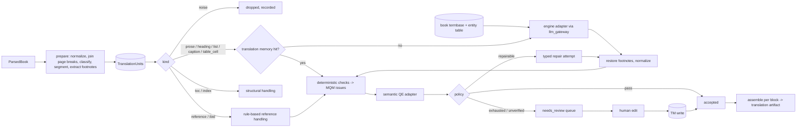

# إعادة بناء مرحلة الترجمة (D-028) — 2026-10-24

الحالة: **Accepted (owner, 2026-10-24)**. اختيار النموذج مؤجَّل؛ التصميم كله model-agnostic.

## 1. لماذا

المراجعة الشاملة لـ 3396 segment (`outputs/translation-review-2026-10-24/TRANSLATION-ERROR-CATALOGUE.md`) أثبتت أن:

- 1904 من 3319 segment "مقبول" (57%) فيها خطأ major/critical.
- 436 segment مقبول فيها **تسريب تعليمات**: خادم Hy-MT (`docker/hy-translation/server.py:90-203`) يدمج التعليمات وقائمة العلامات والـ glossary JSON والسياق والـ retry feedback في رسالة user واحدة لنموذج MT بحجم 1.8B، فيترجمها النموذج ويعيدها كأنها النص.
- نسبة القبول الخاطئ 93% للوحدات ≥1000 حرف، و30% للوحدات <60 حرفًا.
- البوابات الحالية تفحص الشكل فقط (أرقام بنفس الترتيب، أقواس، طول، إنجليزي طويل). لا يوجد فحص تسريب ولا فحص دلالي، رغم أن T-TR-03..06 تطلبه.
- 1091 segment (32%) فيها مشكلة في المصدر (OCR، قطع عند حدّ الصفحة، مراجع، فهارس) تُرسل كما هي إلى النموذج.

الخلاصة: المشكلة في التصميم، لا في عتبة أو نموذج. لذلك يُعاد البناء بدل الترقيع.

## 2. المبادئ (ممارسات معتمدة صناعيًا)

1. **فصل القناة:** النموذج يستقبل نص المصدر فقط في رسالة المستخدم. التعليمات في system message لنماذج الدردشة، أو قالب النموذج الموثّق لنماذج MT. لا JSON ولا علامات ولا feedback داخل النص المُترجَم (يقابل فصل inline codes عن النص في XLIFF 2.x).
2. **لا يُرسل للنموذج ما لا يحتاج نموذجًا:** المراجع والـ Ibid. والفهارس والترويسات تُعالج بقواعد حتمية (ممارسة النشر الأكاديمي العربي: المراجع تبقى بلغتها الأصلية).
3. **وحدات ترجمة قصيرة متماسكة:** تقطيع جُملي (SRX-style) داخل الفقرة، بحد أقصى قابل للضبط (افتراضي 400 حرف)، بعد ضمّ الفقرات المقطوعة عند حدود الصفحات.
4. **العلامات بالكود لا بالنموذج:** أرقام الحواشي تُنزع قبل الترجمة وتُعاد بعدها حتميًا (الوحدة تنتهي دائمًا عند علامة الحاشية، فإعادتها = إلحاقها بنهاية الترجمة). الأرقام العادية تبقى في النص وتُفحص كمجموعة (multiset) لا كتسلسل.
5. **مصطلحات مقفلة (termbase):** قاموس لكل كتاب + جدول أسماء أعلام، يُبنى قبل الترجمة، ويُفرض بعدها بفحص. يقابل TBX وtermbase في أدوات CAT.
6. **بوابة جودة طبقتين (MQM):** فحوص حتمية تُنتج issues بتصنيف MQM وخطورة، ثم تقدير جودة دلالي قابل للتبديل (QE: CometKiwi/xCOMET أو LLM-MQM بنموذج مختلف) — T-TR-03/06.
7. **القبول صريح:** `accepted` فقط إذا نجحت كل الفحوص الحتمية **و**الفحص الدلالي. إن لم يُضبط فحص دلالي، الحالة `needs_review` لا `accepted`. لا يوجد "مقبول لأن الشكل سليم".
8. **إصلاح موجّه ثم إنسان:** محاولات إصلاح محدودة بنوع الخطأ؛ ما يتبقى يذهب لطابور مراجعة بشرية (T-TR-04/05). التصحيح البشري يدخل translation memory فلا يتكرر الخطأ.
9. **قياس قبل وبعد:** مجموعة الاختبار من المراجعة (أهداف خاطئة معروفة + ترجمات مصحّحة) تقيس recall كل فاحص ومعدل إنذاره الكاذب؛ أي تغيير يُقاس عليها.
10. **model-agnostic:** محرك الترجمة ومقدّر الجودة واجهات (Protocols) مع adapters؛ كل الوصول للنماذج عبر `llm_gateway` (القاعدة 5).

## 3. البنية

## 4. الوحدات البرمجية (`packages/translation/src/b2c_translation/`)

| الوحدة | المسؤولية |
|---|---|
| `units.py` | ParsedBook → `TranslationUnit`s: تطبيع OCR، ضمّ حدود الصفحات، تصنيف الكتل، تقطيع جُملي، نزع علامات الحواشي، تجميع الوحدات |
| `references.py` | معالجة المراجع والـ Ibid./op. cit./pp. بقواعد حتمية |
| `termbase.py` | termbase الكتاب + جدول الكيانات: بناء، تخزين، فرض |
| `engines/` | `TranslationEngine` Protocol + `ChatEngine` (LLM، تعليمات في system) + `PlainMTEngine` (نموذج MT، نص فقط بقالبه الموثّق) |
| `prompts.py` | قوالب مُرقّمة الإصدار + بصمات التسريب المشتقة منها آليًا |
| `qa/checks.py`, `qa/leakage.py` | فحوص حتمية؛ كل فحص دالة نقية تُعيد `QAIssue`s |
| `qa/estimators.py` | `QualityEstimator` Protocol + `LLMJudge` (MQM) + نقطة توصيل CometKiwi |
| `qa/policy.py` | قرار accepted / repair / needs_review / rejected |
| `memory.py` | translation memory (Postgres): exact match، أولوية للبشري |
| `book_pipeline.py` | منطق الوحدة الكامل (بدون Temporal): translate → restore → qa → qe → policy → repair |
| `evaluation.py` | تشغيل الفحوص على مجموعة المراجعة: recall/false-positive لكل فئة |

`generation.py` الحالي يبقى للمسار القديم حتى تنتهي الـ workflows الجارية، ثم يُحذف.

## 5. العقود (`b2c_contracts`, SCHEMA_VERSION → 1.2.0)

- `TranslationUnit` (يحل محل العقد غير المستخدم): `unit_id`, `book_id`, `block_ids`, `kind`, `source_text`, `footnote_markers`, `page_refs`, `prev_unit_id`, `next_unit_id`.
- `QAIssue`: `check_id`, `category` (MQM), `severity` (critical/major/minor), `evidence`.
- `UnitTranslation`: `unit_id`, `target_text`, `origin` (engine/rule/memory/human), `engine` (provider, model, revision, prompt_version), `attempts`, `issues`, `qe`, `decision` (accepted/needs_review/rejected/dropped), `decided_by`.

## 6. القياس والبوابات

- مجموعة التقييم: `/mnt/wsl/b2cdata/eval-datasets/translation-audit-2026-10-24/` (محتوى كتب حقيقي؛ على قرص البيانات، لا في git). عيّنة اصطناعية صغيرة في `tests/fixtures` لـ CI.
- مقاييس إلزامية في `eval/reports/translation-v2-*.md`:
  - recall الفحوص الحتمية على الأخطاء المؤكدة حسب الفئة (هدف التسريب 100%، الأرقام والحواشي 100%).
  - معدل الإنذار الكاذب على الترجمات المصحّحة (هدف < 5%).
  - نسبة القبول الخاطئ النهائية بعد QE (الهدف النهائي ≈ 0، تُقاس بعيّنة بشرية).
- T-TR-01..06 تُنفّذ فعليًا ضمن هذه البوابات.

## 7. ما خارج النطاق الآن

- اختيار النموذج (المحرك والـ QE): قرار المالك بعد مقارنة على مجموعة التقييم.
- إعادة ترجمة الكتابين: بعد اكتمال المسار وقياسه.
