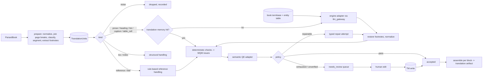

# إعادة بناء مرحلة الترجمة (D-028) — 2026-10-24

الحالة: **Accepted (owner, 2026-10-24)**. اختيار النموذج مؤجَّل؛ التصميم كله model-agnostic.

## 1. لماذا

المراجعة الشاملة لـ 3396 segment (`outputs/translation-review-2026-10-24/TRANSLATION-ERROR-CATALOGUE.md`) أثبتت أن:

- 1904 من 3319 segment "مقبول" (57%) فيها خطأ major/critical.
- 436 segment مقبول فيها **تسريب تعليمات**: خادم Hy-MT (`docker/hy-translation/server.py:90-203`) يدمج التعليمات وقائمة العلامات والـ glossary JSON والسياق والـ retry feedback في رسالة user واحدة لنموذج MT بحجم 1.8B، فيترجمها النموذج ويعيدها كأنها النص.
- نسبة القبول الخاطئ 93% للوحدات ≥1000 حرف، و30% للوحدات <60 حرفًا.
- البوابات الحالية تفحص الشكل فقط (أرقام بنفس الترتيب، أقواس، طول، إنجليزي طويل). لا يوجد فحص تسريب ولا فحص دلالي، رغم أن T-TR-03..06 تطلبه.
- 1091 segment (32%) فيها مشكلة في المصدر (OCR، قطع عند حدّ الصفحة، مراجع، فهارس) تُرسل كما هي إلى النموذج.

الخلاصة: المشكلة في التصميم، لا في عتبة أو نموذج. لذلك يُعاد البناء بدل الترقيع.

## 2. المبادئ (ممارسات معتمدة صناعيًا)

1. **فصل القناة:** النموذج يستقبل نص المصدر فقط في رسالة المستخدم. التعليمات في system message لنماذج الدردشة، أو قالب النموذج الموثّق لنماذج MT. لا JSON ولا علامات ولا feedback داخل النص المُترجَم (يقابل فصل inline codes عن النص في XLIFF 2.x).
2. **لا يُرسل للنموذج ما لا يحتاج نموذجًا:** المراجع والـ Ibid. والفهارس والترويسات تُعالج بقواعد حتمية (ممارسة النشر الأكاديمي العربي: المراجع تبقى بلغتها الأصلية).
3. **وحدات ترجمة قصيرة متماسكة:** تقطيع جُملي (SRX-style) داخل الفقرة، بحد أقصى قابل للضبط (افتراضي 400 حرف)، بعد ضمّ الفقرات المقطوعة عند حدود الصفحات.
4. **العلامات بالكود لا بالنموذج:** أرقام الحواشي تُنزع قبل الترجمة وتُعاد بعدها حتميًا (الوحدة تنتهي دائمًا عند علامة الحاشية، فإعادتها = إلحاقها بنهاية الترجمة). الأرقام العادية تبقى في النص وتُفحص كمجموعة (multiset) لا كتسلسل.
5. **مصطلحات مقفلة (termbase):** قاموس لكل كتاب + جدول أسماء أعلام، يُبنى قبل الترجمة، ويُفرض بعدها بفحص. يقابل TBX وtermbase في أدوات CAT.
6. **بوابة جودة طبقتين (MQM):** فحوص حتمية تُنتج issues بتصنيف MQM وخطورة، ثم تقدير جودة دلالي قابل للتبديل (QE: CometKiwi/xCOMET أو LLM-MQM بنموذج مختلف) — T-TR-03/06.
7. **القبول صريح:** `accepted` فقط إذا نجحت كل الفحوص الحتمية **و**الفحص الدلالي. إن لم يُضبط فحص دلالي، الحالة `needs_review` لا `accepted`. لا يوجد "مقبول لأن الشكل سليم".
8. **إصلاح موجّه ثم إنسان:** محاولات إصلاح محدودة بنوع الخطأ؛ ما يتبقى يذهب لطابور مراجعة بشرية (T-TR-04/05). التصحيح البشري يدخل translation memory فلا يتكرر الخطأ.
9. **قياس قبل وبعد:** مجموعة الاختبار من المراجعة (أهداف خاطئة معروفة + ترجمات مصحّحة) تقيس recall كل فاحص ومعدل إنذاره الكاذب؛ أي تغيير يُقاس عليها.
10. **model-agnostic:** محرك الترجمة ومقدّر الجودة واجهات (Protocols) مع adapters؛ كل الوصول للنماذج عبر `llm_gateway` (القاعدة 5).

## 3. البنية



## 4. الوحدات البرمجية (`packages/translation/src/b2c_translation/`)

| الوحدة | المسؤولية |
|---|---|
| `units.py` | ParsedBook → `TranslationUnit`s: تطبيع OCR، ضمّ حدود الصفحات، تصنيف الكتل، تقطيع جُملي، نزع علامات الحواشي، تجميع الوحدات |
| `references.py` | معالجة المراجع والـ Ibid./op. cit./pp. بقواعد حتمية |
| `termbase.py` | termbase الكتاب + جدول الكيانات: بناء، تخزين، فرض |
| `engines/` | `TranslationEngine` Protocol + `ChatEngine` (LLM، تعليمات في system) + `PlainMTEngine` (نموذج MT، نص فقط بقالبه الموثّق) |
| `prompts.py` | قوالب مُرقّمة الإصدار + بصمات التسريب المشتقة منها آليًا |
| `qa/checks.py`, `qa/leakage.py` | فحوص حتمية؛ كل فحص دالة نقية تُعيد `QAIssue`s |
| `qa/estimators.py` | `QualityEstimator` Protocol + `LLMJudge` (MQM) + نقطة توصيل CometKiwi |
| `qa/policy.py` | قرار accepted / repair / needs_review / rejected |
| `memory.py` | translation memory (Postgres): exact match، أولوية للبشري |
| `book_pipeline.py` | منطق الوحدة الكامل (بدون Temporal): translate → restore → qa → qe → policy → repair |
| `evaluation.py` | تشغيل الفحوص على مجموعة المراجعة: recall/false-positive لكل فئة |

`generation.py` الحالي يبقى للمسار القديم حتى تنتهي الـ workflows الجارية، ثم يُحذف.

## 5. العقود (`b2c_contracts`, SCHEMA_VERSION → 1.2.0)

- `TranslationUnit` (يحل محل العقد غير المستخدم): `unit_id`, `book_id`, `block_ids`, `kind`, `source_text`, `footnote_markers`, `page_refs`, `prev_unit_id`, `next_unit_id`.
- `QAIssue`: `check_id`, `category` (MQM), `severity` (critical/major/minor), `evidence`.
- `UnitTranslation`: `unit_id`, `target_text`, `origin` (engine/rule/memory/human), `engine` (provider, model, revision, prompt_version), `attempts`, `issues`, `qe`, `decision` (accepted/needs_review/rejected/dropped), `decided_by`.

## 6. القياس والبوابات

- مجموعة التقييم: `/mnt/wsl/b2cdata/eval-datasets/translation-audit-2026-10-24/` (محتوى كتب حقيقي؛ على قرص البيانات، لا في git). عيّنة اصطناعية صغيرة في `tests/fixtures` لـ CI.
- مقاييس إلزامية في `eval/reports/translation-v2-*.md`:
  - recall الفحوص الحتمية على الأخطاء المؤكدة حسب الفئة (هدف التسريب 100%، الأرقام والحواشي 100%).
  - معدل الإنذار الكاذب على الترجمات المصحّحة (هدف < 5%).
  - نسبة القبول الخاطئ النهائية بعد QE (الهدف النهائي ≈ 0، تُقاس بعيّنة بشرية).
- T-TR-01..06 تُنفّذ فعليًا ضمن هذه البوابات.

## 7. ما خارج النطاق الآن

- اختيار النموذج (المحرك والـ QE): قرار المالك بعد مقارنة على مجموعة التقييم.
- إعادة ترجمة الكتابين: بعد اكتمال المسار وقياسه.

## 8. التشغيل (الجزء D — 2026-10-24)

### 8.1 الـ workflow والـ activities

workflow جديد باسم `TranslateBookWorkflow` في `packages/orchestration/src/b2c_orchestration/translate_book.py`، بأسماء activities جديدة. يُسجَّل بجانب `TranslateContentWorkflow` القديم ولا يغيّر أوامره، لأن تنفيذًا قديمًا متوقفًا في الإنتاج يجب أن يبقى قابلًا لإعادة التشغيل (replay).

| الخطوة | الـ activity | ما تفعله |
|---|---|---|
| 1 | `prepare_translation_units` | تقرأ `ParsedBook` من artifact المرحلة `ingest-parse-pdf` للكورس نفسه، وتبني الوحدات بـ `build_units_with_provenance`، وتخزّنها artifact ثابتًا بالمرحلة `translation-units`. الملفات: `units.json` و`build.json`. المفتاح `stage_key` يُحسب من sha الكتاب المحلَّل و`max_unit_chars` و`UNITS_BUILDER_VERSION`. تسجّل الـ run في Postgres. |
| 1أ | `build_book_termbase` | تستخرج المرشّحين من الوحدات المخزّنة، وتجمع المقترحات العربية، وتدمجها في حالة المراجعة في Postgres دون أن تمسّ أي قرار بشري، وتخزّن الـ termbase المدموج artifact مُرقّم الإصدار بالمرحلة `book-termbase`. لا تعتمد شيئًا. التفاصيل في §8.8. |
| 1ب | `check_book_termbase` | بوابة الاعتماد: تحسب الإدخالات المعلّقة. إذا كانت البوابة مفتوحة، تجمّد الإدخالات **المعتمدة فقط** في artifact بالمرحلة `book-termbase-approved` وتعيد الـ digest الخاص بها. |
| 2 | `translate_unit_batch` | دفعة محدودة الحجم (`batch_size`، الافتراضي 25، والحد الأقصى 200). تتخطى كل وحدة لها نتيجة نهائية (`accepted`/`dropped`/`rejected`) أو قرار بشري. تشغّل `UnitTranslator` مع سياق الوحدتين المجاورتين، وترسل heartbeat لكل وحدة، وتكتب نتيجة كل وحدة فور صدورها. لذلك لا يضيع عند السقوط أكثر من وحدة واحدة. أخطاء المحرك الحتمية (وحدة أطول من حد المحرك، `LLMOutputTruncated`، `LLMRequestRejected`، `InvalidLLMOutput`) تُسجَّل وحدةً `rejected` فيها issue ‏`engine_error`، وتذهب إلى المراجعة بدل أن تُفشل الدفعة. |
| 3 | `assemble_translation` | تجمع النص لكل block بـ `assemble_blocks`، من الوحدات `accepted`/`dropped` فقط. نص المحرك غير المتحقق منه لا يدخل الـ artifact أبدًا. تكتب artifact بالمرحلة `translate-book` يحتوي `translation.json` = `{blocks: {block_id: {text, complete, pending_unit_ids, merged_into}}, counts, engines, units_ref, results_digest, run_id}`. مفتاحه يتضمن digest النتائج، فكل تعديل بشري لاحق ينتج artifact جديدًا ولا يُكتب فوق القديم. |

الـ timeouts محدودة: لكل activity ‏`heartbeat_timeout` مقداره 5 دقائق، و`start_to_close` مقداره 30 دقيقة للتحضير والتجميع و3 ساعات للدفعة. عدد المحاولات محدود (3 أو 5)، والأخطاء الحتمية غير قابلة لإعادة المحاولة: `InvalidTranslationSource`، `UnknownTranslationUnit`، `UnknownTranslationProfile`، `TranslationProfileChanged`، `QualityEstimatorNotConfigured`، `CloudProviderNotAllowed`، إضافةً إلى قائمة `DEFAULT_RETRY`.

`run_id` حتمي: sha256 للكورس، وsha الكتاب المحلَّل وuri الخاص به، واللغتين، واسم ملف المحرك، واسم ملف الـ QE، وبصمة الملفين، و`max_unit_chars`، و`UNITS_BUILDER_VERSION`. `batch_size` لا يدخل فيه لأن التقسيم إلى دفعات لا يغيّر نتيجة أي وحدة. معرّف الـ workflow هو `b2c-translate-book-<run_id>`، ويُبدأ بـ `ALLOW_DUPLICATE_FAILED_ONLY`، فإذا أُعيد الـ POST نفسه أعاد الـ run الموجود.

### 8.2 الحالة الدائمة (Postgres، لا JSON تحت `_system/`)

في `packages/orchestration/src/b2c_orchestration/translation_store.py`:

- `translation_unit_results(run_id, unit_id, book_id, seq, decision, origin, decided_by, translation_json, drafts_json, updated_at)`، مفتاحه `(run_id, unit_id)`. في جملة الـ upsert شرط `WHERE` يمنع أي نتيجة policy من الكتابة فوق قرار بشري، ولا يستبدل القرار البشري إلا قرار بشري لاحق.
- `translation_runs(run_id, course_id, workflow_id, book_id, input_json, units_ref_json, unit_count, assembly_json, assembly_snapshot_at, …)`. تجميع مبني على لقطة أقدم لا يحل محل تجميع أحدث.
- عمود `termbase_digest` في `translation_unit_results` (يُضاف بـ `ADD COLUMN IF NOT EXISTS`): digest الـ termbase المعتمد الذي أُنتجت به النتيجة. نتيجة الـ policy لا تُعدّ نهائية إلا مع الـ digest نفسه، والقرار البشري نهائي دائمًا.
- `book_termbase_entries` و`book_termbase_builds` في `termbase_store.py` (انظر §8.8).
- يُنشأ الـ schema مرة واحدة لكل instance.

### 8.3 الطابور والعامل

- طابور جديد اسمه `translate-book` (`queues.TRANSLATE_BOOK`)، وحده الأقصى activity واحدة في الوقت نفسه. يعمل داخل الـ worker الرئيسي (`b2c-worker` في الوضع العادي) كـ `Worker` رابع بجانب `light`/`heavy`/`io`، ويسجّل `TranslateBookWorkflow` و`AssembleBookTranslationWorkflow` والـ activities الثلاث. تسجيلات الطوابير الأخرى لم تتغير.
- لا يشغّل عامل `hy-translation-worker` (الوضع `generation`) هذا الطابور. العامل الرئيسي يصل إلى خادم Hy عبر شبكة compose عندما يكون الـ profile ‏`hy-translation` مشغّلًا.
- إذا كان ملف الملفات (profiles) غير صالح، لا يتوقف الـ worker. تفشل كل دفعة على هذا الطابور فشلًا غير قابل لإعادة المحاولة وتذكر السبب، وتستمر الطوابير الأخرى في العمل.

### 8.4 ملفات المحرك والـ QE (profiles)

في `packages/orchestration/src/b2c_orchestration/translation_profiles.py`. يختار العميل **اسمًا** فقط، أما العنوان والمفتاح فهما من إعداد الـ worker.

| الاسم | النوع | التفاصيل |
|---|---|---|
| `configured-llm` | `chat` → `ChatEngine` | نموذج التعليمات المضبوط في `B2C_LLM_BASE_URL`/`B2C_LLM_MODEL_ID`. يدعم terms وcontext وrepair. |
| `hy-mt2` | `plain_mt` → `PlainMTEngine` (القالب `hy-mt2`) | `tencent/Hy-MT2-1.8B` بالـ revision ‏`9a341cd1b679d3efd23b46e847b01745a71ed792`، عبر المسار النظيف `http://hy-translation-proxy:3007/plain/v1`. يمكن تغيير العنوان بـ `B2C_HY_PLAIN_BASE_URL`. لا repair. |

لإضافة ملفات أخرى، أو استبدال ملفات مدمجة، يُستخدم ملف JSON يُشار إليه بـ `B2C_TRANSLATION_PROFILES_FILE`، ويجب أن يكون متاحًا للـ worker والـ API معًا:

```json
{"engines": [{"id": "gemma-chat", "kind": "chat", "provider": "local", "base_url": "http://llm:8080/v1",
              "model_id": "…", "revision": "…", "supports_terms": true, "supports_context": true,
              "supports_repair": true, "max_source_chars": 1200}],
 "qe": [{"id": "judge-local", "kind": "llm_judge", "provider": "local", "base_url": "http://llm:8080/v1",
         "model_id": "…", "prompt_version": "llm-mqm@1", "max_major": 0},
        {"id": "kiwi", "kind": "cometkiwi", "model_path": "/data/models/cometkiwi/<rev>/checkpoints/model.ckpt",
         "threshold": 0.0}]}
```

- كل الوصول للنماذج يمر عبر `LLMGateway` (القاعدة 5)، بنفس الـ cache في Postgres. أي endpoint بعيد يُرفض (`CloudProviderNotAllowed`) إلا إذا ضُبط في الملف صراحةً `allow_remote: true` ومعه `api_key_file` (D-004/D-022).
- **لا يوجد ملف QE افتراضي.** دون `qe_profile` تنتهي كل نتيجة محرك بـ `needs_review`، وهذا هو السلوك الصحيح (المبدأ 7)، وليس عطلًا يُلتف عليه. عتبة CometKiwi وحدود الـ judge تُعايَر على مجموعة التقييم (T-TR-03/06) قبل استعمالها. القيمة `0.0` في المثال أعلاه placeholder فقط.
- **بصمة الملف** (`profile_fingerprint`) هي sha256 للنموذج والـ revision والعنوان والقالب والقدرات وعتبات الـ QE، ولا تتضمن المفتاح ولا الـ timeout. تدخل في `run_id`. إذا تغيّر الملف أثناء run، ترفض الدفعة المتابعة (`TranslationProfileChanged`)، فلا تختلط نتائج نموذجين في run واحد (تدقيق 08 §3.3).
- الـ translation memory (`translation_memory`) مربوطة: القرار البشري يُعاد استعماله كما هو، والقبول الآلي يُكتب فيها.

### 8.5 الـ API

| الطلب | الوظيفة |
|---|---|
| `POST /v2/courses/{course_id}/book-translations` | بدء run. الجسم: `source_artifact_ref` (artifact ‏`ingest-parse-pdf` ملتزم في الكورس نفسه)، و`source_language`، و`target_language`، و`engine_profile`، و`qe_profile` (اختياري)، و`max_unit_chars` (الافتراضي 400)، و`batch_size` (الافتراضي 25)، و`require_approved_termbase` (الافتراضي `true`)، و`termbase_min_frequency` (الافتراضي 1). يُرفض أي حقل زائد. الرد 202 ومعه `run_id` و`workflow_id` و`existing`. |
| `GET /v2/book-translations/{run_id}` | حالة الـ run وحالة الـ workflow، والعدد لكل قرار (`accepted`/`needs_review`/`rejected`/`dropped`/`pending`)، و`units_ref`، وآخر تجميع. |
| `GET /v2/book-translations/{run_id}/review-queue?decision=needs_review&decision=rejected&limit=50&offset=0` | طابور المراجعة البشرية. لكل وحدة: نص المصدر، والعلامات، والصفحات، وآخر مسودة، والـ issues، وتاريخ المسودات كاملًا. |
| `POST /v2/book-translations/{run_id}/units/{unit_id}/review` | قرار بشري: `{"action": "accept"}` لقبول النص الحالي كما هو، أو `{"action": "edit", "text": "…"}`، ومع أيٍّ منهما `"reviewer_id": "…"`. يُفحص النص أولًا بفحص التسريب وفحص علامات الحواشي، فإن فشل أُعيد 422 مع الـ issues ولم يُكتب شيء. إن نجح خُزّن `origin=human, decided_by=human, accepted` في جدول النتائج وفي الـ translation memory، ودخل معرّف المراجع ونتائج كل الفحوص في تاريخ المسودات. |
| `POST /v2/book-translations/{run_id}/assemblies` | إعادة التجميع بعد المراجعة عبر `AssembleBookTranslationWorkflow`. معرّفه مشتق من `run_id` ومن revision النتائج الحالية، فالطلب المكرر دون تغيير لا يبدأ تجميعًا ثانيًا. |

المعرّفات تُفحص بصرامة: `run_id` يتكون من 64 حرفًا hex بأحرف صغيرة، و`unit_id` على الشكل `book:u00000`. الـ run أو الوحدة غير الموجودة تعطي 404، والوحدة التي لم تُحضَّر أو لا نتيجة لها أو المحذوفة (`dropped`) تعطي 409.

### 8.6 كيف يُشغَّل

1. بناء صورة الـ worker والـ API من هذا الفرع ثم إعادة تشغيلهما بـ `make up` أو `make start`، بقرار المالك. **لم يُنفَّذ في هذا العمل:** لم أبنِ أي صورة ولم أُعد تشغيل أي شيء.
2. عند استعمال `hy-mt2`: `make up PROFILES=hy-translation`، مع التأكد أن الـ worker الرئيسي يرى `hy-translation-proxy`.
3. بدء run:
   ```bash
   curl -X POST http://localhost:8000/v2/courses/<course>/book-translations \
     -H 'content-type: application/json' \
     -d '{"source_artifact_ref": {…ArtifactRef ingest-parse-pdf…}, "source_language": "en",
          "target_language": "ar", "engine_profile": "hy-mt2"}'
   ```
4. مراجعة الـ termbase واعتماده (§8.8)، ثم `termbase/done`. قبل ذلك لا تُترجم أي وحدة.
5. المتابعة عبر `GET /v2/book-translations/<run_id>`، ثم المراجعة عبر `review-queue`، ثم القرار البشري، ثم `assemblies`.

### 8.7 حدود معروفة

- الـ termbase وجدول الكيانات مربوطان الآن (§8.8). مصادر Wikidata/AGROVOC ‏(`ConceptIndexSource`) لها نقطة توصيل (`concept_sources`) في الـ activities، لكن الـ worker لا يمرّر فهارس بعد، فهي غير مفعّلة.
- لم يُختبر المسار على Temporal وPostgres ونماذج حقيقية. اختبار التكامل `tests/integration/test_translation_store_postgres.py` يعمل فقط داخل شبكة b2c (`make test-integration`).
- الوحدة التي نتيجتها `needs_review` تُترجم مرة أخرى عند استئناف دفعة. هذا مقصود: الطلب نفسه بـ temperature 0 يُخدم من cache الـ gateway، والـ judge الذي فشل لخلل مؤقت (فشل مغلق) يحصل على فرصة ثانية. CometKiwi لا يمر عبر cache، فيُحسب من جديد.
- الـ termbase في Postgres لا يُقفل بين مراجِعَين متزامنين: قراران متزامنان على الإدخال نفسه يفوز فيهما الأخير. التحقق من "هدف واحد لكل مصدر" ومن الأهداف المشتركة يجري على الحالة المقروءة لحظة الطلب.

### 8.8 الـ termbase وبوابة الاعتماد (المبدأ 5، Gate G3 — 2026-10-24)

القاعدة: المصطلحات المقفلة **يعتمدها إنسان قبل الترجمة، وتُفرض بعدها**. لا يُعتمد أي إدخال آليًا في أي مسار.

**الخطوة في الـ workflow.** بعد `prepare_translation_units` وقبل أول دفعة، ومحميّة بـ `workflow.patched("book-termbase-gate-v1")`. لهذا يُعاد تشغيل أي تاريخ سُجّل قبلها بالأوامر القديمة نفسها. يوجد اختبار replay لذلك.

1. `build_book_termbase(course_id, units_ref, engine_profile, …)`:
   - تقرأ الوحدات المخزّنة، وتستخرج المرشّحين بـ `b2c_translation.termbase.build_book_termbase`، وهي الواجهة العامة فقط.
   - المقترحات، مرتّبة حسب المصدر: الـ glossary السياقي إن أُرسل في الطلب (`contextual_glossary`)، ثم الإدخالات المعتمدة للكتاب نفسه في أي كورس (`prior_termbase`)، ثم الترجمات البشرية في الـ translation memory، ثم نموذج المحرك **فقط إذا فعّله ملف المحرك** (`"propose_terms": true`، لملف `chat` محلي فقط، وعبر `llm_gateway`)، ثم النقل الحرفي لأسماء الأشخاص.
   - الدمج مع حالة المراجعة يكون بالصيغة المطبّعة للمصدر (`source_key`). الاستخراج الجديد يحدّث أعمدته فقط (النوع، التكرار، المرشّح، المقترحات)، ولا يكتب أبدًا `status` أو `target` أو `reviewer` أو `decided_at`. الإدخال الذي لم يعد يُستخرج يبقى بقراره، مع `present = false`.
   - تُكتب الحالة المدموجة كاملة artifact بالمرحلة `book-termbase` (`termbase.json`، JSON قانوني مع sha256). كل تغيير ينتج إصدارًا جديدًا.
2. `check_book_termbase`: الإدخالات "الحاجزة" هي المعلّقة (`pending`) التي ما زالت مستخرجة وتكرارها ≥ `termbase_min_frequency`.
   - مع `require_approved_termbase = true` (الافتراضي للكتب الحقيقية): إذا وُجد إدخال حاجز، ينتظر الـ workflow إشارة `termbase_approved` (`{"reviewer_id": "…"}`)، ثم يعيد الفحص بعد كل إشارة. إذا لم يوجد إدخال حاجز من البداية، يتابع مباشرة.
   - مع `require_approved_termbase = false`: لا انتظار. تُستعمل الإدخالات المعتمدة فقط، وتُتجاهل المعلّقة ولا تُعتمد.
   - عند فتح البوابة تُجمَّد الإدخالات المعتمدة وحدها في artifact بالمرحلة `book-termbase-approved`، مع digest يغطي بالضبط ما تستعمله الترجمة: `locked_terms()` و`entity_table()` و`forbidden_variants()` واللغتين.
3. كل دفعة تقرأ اللقطة المجمّدة، وتتحقق من الـ digest (`TermbaseChanged` غير قابل لإعادة المحاولة عند الاختلاف)، ثم تمرّر `locked_terms()` → `UnitTranslator.terms` و`entity_table()` → `entities`.

**إعادة استعمال النتائج.** `run_id` لا يتغير بخيارات البوابة. كل نتيجة تُخزَّن مع `termbase_digest`. الدفعة المستأنفة بالـ termbase المعتمد نفسه تتخطى نتائجها النهائية. إذا تغيّر الـ termbase المعتمد (run أُعيد تشغيله بعد فشل مثلًا)، يتغير الـ digest، فتُترجم الوحدات من جديد، ولا تُعاد نتائج أُنتجت بمصطلحات مقفلة مختلفة. القرارات البشرية على الوحدات تبقى دائمًا.

**الـ query.** `termbase_state` يعيد: `phase` (`building` / `awaiting_approval` / `approved`)، و`counts` (`pending_blocking`, `pending_total`, `approved`, `rejected`, `absent`, `min_frequency`)، و`checks`، و`signals`، و`last_reviewer`، و`digest`، و`approved_ref`. يظهر أيضًا في `GET /v2/book-translations/{run_id}` تحت `termbase` ما دام الـ workflow يعمل.

**حالة المراجعة في Postgres** (`termbase_store.py`):

- `book_termbase_entries`، مفتاحه `(course_id, book_id, source_language, target_language, source_key)`: `source`، و`kind`، و`frequency`، و`candidate_json`، و`proposals_json`، و`present`، و`status` (`pending`/`approved`/`rejected`)، و`target` (هدف واحد لكل مصدر)، و`forbidden_variants_json`، و`allow_shared_target`، و`reviewer`، و`decided_at`، و`rejection_reason`، و`extracted_at`، و`updated_at`.
- `book_termbase_builds`: آخر artifact مستخرج لكل نطاق، مع الـ sha وعدد الإدخالات.

**الـ API** (المصادقة bearer كباقي المسارات؛ `run_id` يتكون من 64 حرفًا hex؛ `reviewer_id` إلزامي في كل قرار):

| الطلب | الوظيفة |
|---|---|
| `GET /v2/book-translations/{run_id}/termbase?status=pending&kind=person&min_frequency=2&q=…&include_absent=false&limit=100&offset=0` | الإدخالات مرتّبة بالتكرار، مع المقترحات ومصادرها، وسياق التعريف، وعدّادات البوابة، وartifact آخر استخراج. |
| `POST …/termbase/approve` `{"source": "…", "target": "…" (اختياري، وإلا أول مقترح), "reviewer_id": "…", "replace": false, "allow_shared_target": false}` | اعتماد إدخال واحد، مع هدف معدَّل اختياريًا. |
| `POST …/termbase/reject` `{"source": "…", "reviewer_id": "…", "reason": "…"}` | رفض صريح. الإدخال المرفوض لا يحجز البوابة ولا يُستعمل. |
| `POST …/termbase/bulk-approve` `{"reviewer_id": "…", "selections": [{"source": "…", "target": "…" (اختياري)}]}` | اعتماد المقترحات التي اختارها المراجع، حتى 500 في الطلب. كل هدف يجب أن يكون أحد مقترحات الإدخال نفسه. الطلب كله يُقبل أو يُرفض كله. |
| `POST …/termbase/done` `{"reviewer_id": "…"}` | يرسل الإشارة `termbase_approved` إلى الـ workflow المنتظر. يعيد 409 مع العدّادات ما دام هناك إدخال حاجز، و409 إذا لم يكن الـ workflow منتظرًا. |

**التحقق.** الهدف نص عربي غير فارغ: حرف عربي واحد على الأقل، ولا حروف لاتينية، وحتى 120 حرفًا (أرقام ومسافات وشرطات مسموحة). كل مصدر له هدف واحد: تغيير هدف معتمد يحتاج `"replace": true`، والهدف المقفل لمصدر آخر يُرفض إلا مع `"allow_shared_target": true`. المراجع الآلي (`g3-policy-*`) مرفوض. الأخطاء: 422 للقرار غير الصالح، و404 للمصدر أو الـ run غير الموجود، و409 إذا لم تُحضَّر الوحدات أو لم يُبنَ الـ termbase بعد.

مثال لدورة كاملة:

```bash
RUN=…  # run_id من POST /v2/courses/<course>/book-translations
curl -H "authorization: Bearer $TOKEN" "http://localhost:8000/v2/book-translations/$RUN/termbase?status=pending&min_frequency=2"
curl -H "authorization: Bearer $TOKEN" -H 'content-type: application/json' \
  -d '{"reviewer_id": "aly", "selections": [{"source": "Signal Mapping"}, {"source": "Lena Vasquez"}]}' \
  "http://localhost:8000/v2/book-translations/$RUN/termbase/bulk-approve"
curl -H "authorization: Bearer $TOKEN" -H 'content-type: application/json' \
  -d '{"source": "ARH", "target": "تحليل الفرضيات المتنافسة", "reviewer_id": "aly"}' \
  "http://localhost:8000/v2/book-translations/$RUN/termbase/approve"
curl -H "authorization: Bearer $TOKEN" -H 'content-type: application/json' \
  -d '{"reviewer_id": "aly"}' "http://localhost:8000/v2/book-translations/$RUN/termbase/done"
```

**ما لم يُنفَّذ:** لم يُبنَ أي image، ولم يُعد تشغيل أي خدمة، ولم يُشغَّل المسار على Temporal وPostgres حقيقيين. الاختبارات تستعمل fakes لـ Postgres، وmoto لـ S3، وبيئة Temporal ذات الوقت المتسارع (time-skipping).
